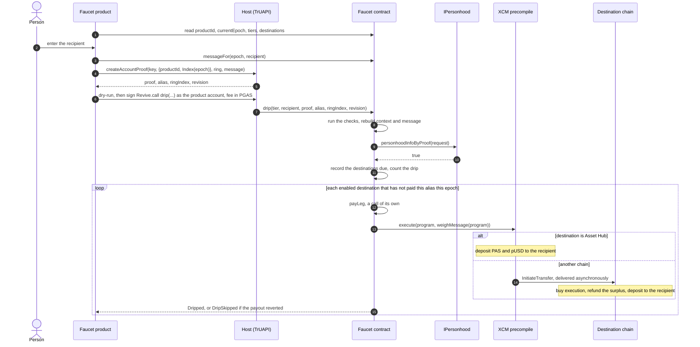
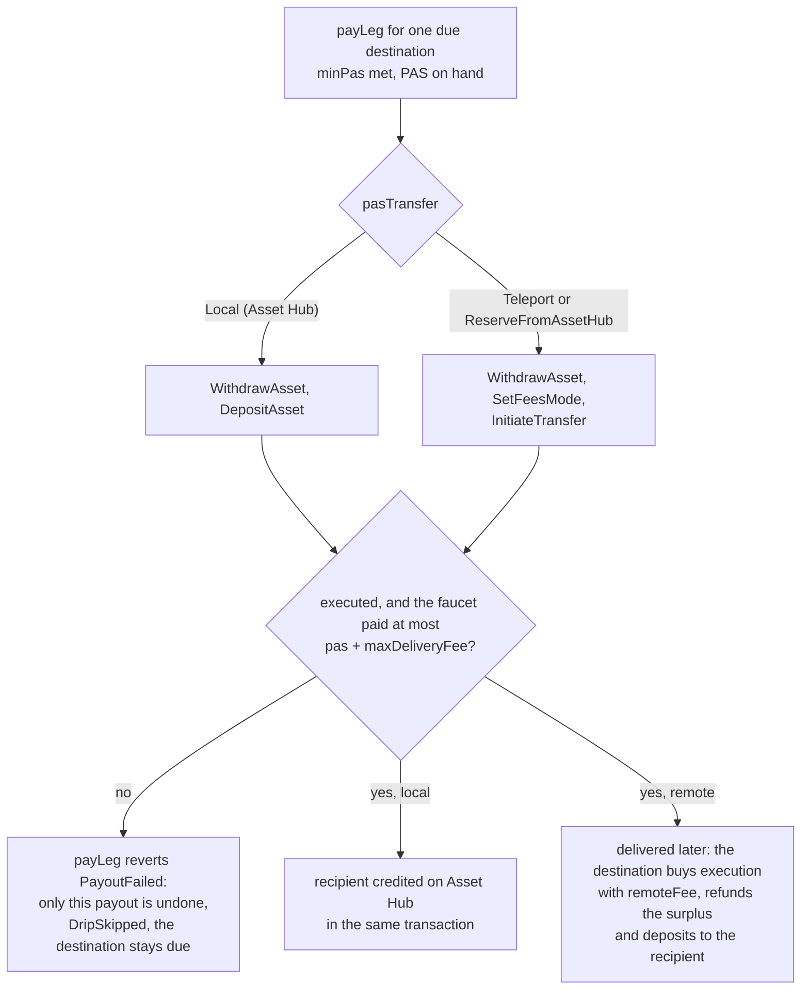
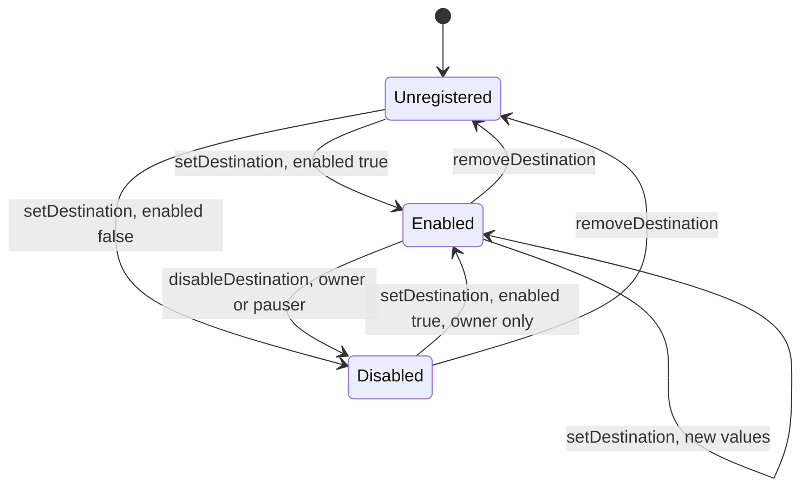

# Paseo personhood-based faucet

A contract on Paseo Asset Hub that pays PAS and pUSD (the Paseo counterpart of dotUSD) at most
once per person, tier, epoch and chain. A person proves membership of People or People Lite
with a ring proof, which the contract checks with the `IPersonhood` precompile against a
context and a message it derives itself. One claim pays the recipient on Asset Hub and, by XCM,
on every other enabled chain. No server holds funds or keys, and no server decides who is
eligible.

The front-end is a DotNS product that runs inside the Polkadot hosts. The candidate UI is in
[`frontend/`](frontend/README.md), using the current contract ABI and the existing Polkadot
faucet's visual design. It is local development work, not a deployed product; see
[Integrating a front-end](#integrating-a-front-end) for the contract protocol.

**Status:** the contract is implemented, unit tested and checked on forks of the live Paseo
runtimes. It is not deployed. Next come a whitelist for trusted users and three more
destinations; two spikes are also still open. See
[Status](#status) and [Remaining work](#remaining-work).

1. [How a claim works](#how-a-claim-works)
2. [The contract](#the-contract)
3. [Destinations and XCM programs](#destinations-and-xcm-programs)
4. [Destination lifecycle](#destination-lifecycle)
5. [Repository layout](#repository-layout)
6. [Build and test](#build-and-test)
7. [Fork check](#fork-check)
8. [Deployment](#deployment)
9. [Operations](#operations)
10. [Integrating a front-end](#integrating-a-front-end)
11. [Status](#status)
12. [Remaining work](#remaining-work)
13. [Open decisions](#open-decisions)
14. [Documents](#documents)
15. [License](#license)

## How a claim works



The contract never takes the context or the message from the caller. It rebuilds both from
the call arguments, so a copied proof cannot be redirected to another recipient, epoch or
contract. The message names no destination: a claim pays every enabled one.

## The contract

`contracts/src/PaseoFaucet.sol`, Solidity 0.8.34 compiled to EVM bytecode (cancun, optimizer at
200 runs). It is not upgradeable, has no delegate call and no self-destruct, and follows
checks, effects, interactions.

### Roles

| Role | Can call |
|---|---|
| Owner | `setTier`, `setMaxDripsPerEpoch`, `setPauser`, `unpause`, `setDestination`, `removeDestination`, `withdraw`, `transferOwnership`, plus everything the pauser can |
| Pauser | `pause`, `disableDestination` |
| Pending owner | `acceptOwnership` |
| Anyone | `drip`, the views, and plain PAS or pUSD transfers to fund the contract |
| The faucet itself | `payLeg`, which `drip` calls once per destination |

The deployer is the first owner. Ownership moves in two steps: `transferOwnership(next)` sets
`pendingOwner`, and only that address can `acceptOwnership()`. Proposing `address(0)` cancels a
pending transfer.

### State

| Item | Set by | Notes |
|---|---|---|
| `productId`, `epochSeconds` | constructor | Fixed for the contract's life. `productId` must be the DotNS name the product is served from, because it fixes every proof context. The constructor reverts `InvalidConfig` on an empty `productId` or a zero `epochSeconds`. |
| `owner`, `pendingOwner`, `pauser`, `paused` | owner, pauser | |
| `maxDripsPerEpoch` | owner | Global cap on drips per epoch. A drip is an alias's first payout in the epoch; claiming skipped destinations later does not count again. |
| `tiers(tier)` | owner | `(enabled, pas, pusd)` for `Lite` (1) and `Full` (2). The numeric value is the `IPersonhood` status the proof must attest. `Tier.None` (0) cannot be configured. |
| `dripsInEpoch(epoch)` | `drip` | |
| `hasClaimed(epoch, tier, contextAlias, id)` | `drip` | Whether destination `id` has paid the alias: the nullifier, one per destination. Stored as one bitmap per epoch, tier and alias; never deleted. |
| `destination(id)`, `destinations()` | owner, pauser | The registry ([below](#destinations-and-xcm-programs)). `destination(id)` returns a flat tuple, all zeros for an unknown id; `destinations()` returns the registered entries in the order their ids were first registered. |

A new deployment is inert: both tiers are disabled, the cap is 0 and there are no
destinations. The constants `DOMAIN`, `INDEX_MAGIC`, `ASSET_HUB` (1000), `RELAY` (0) and the
precompile addresses are public.

| Precompile | Address |
|---|---|
| `IPersonhood` | `0x000000000000000000000000000000000a010000` |
| `ISystem` | `0x0000000000000000000000000000000000000900` |
| XCM | `0x00000000000000000000000000000000000A0000` |
| pUSD ERC20 (asset `50000413`) | `0x02FaF21d00000000000000000000000001200000` |

### Units

- PAS amounts in the API are **plancks**: 1 PAS = 10^10 plancks. pallet-revive counts 1 planck
  as 10^8 wei, so 1 PAS is 10^18 wei and EVM tools print PAS where they say "ether".
- pUSD amounts are **base units**: 6 decimals, so 1 pUSD = 1,000,000.
- `balances()` returns the spendable PAS in plancks (free balance minus the existential
  deposit) and the pUSD held in base units.

### Drip rules, in order

`drip(tier, recipient, proof, contextAlias, ringIndex, revision)`. A destination is *due* when
it is enabled and has not paid `(epoch, tier, contextAlias)` yet.

| # | Rule | Error |
|---|---|---|
| 1 | The faucet is not paused. | `FaucetPaused` |
| 2 | The tier is enabled. | `TierDisabled` |
| 3 | If the alias has no payout this epoch, drips this epoch are below `maxDripsPerEpoch`. | `EpochCapReached` |
| 4 | Some destination is due. | `AlreadyClaimed`; `NothingToPay` if the alias has no payout this epoch |
| 5 | Some due destination can be funded: the tier's PAS is at least its `minPas`, and spendable PAS covers the tier's PAS plus its `maxDeliveryFee`. | `NothingToPay` |
| 6 | `personhoodInfoByProof` returns true for `expectedStatus = tier`, the proof, `contextAlias`, `ringIndex`, `revision`, `contextFor(epoch)` and `messageFor(epoch, recipient)`. | `InvalidProof` |
| 7 | Record every due destination as paid, and count the drip if the alias has no payout this epoch. | |
| 8 | Pay each due destination in registry order, as below. | |
| 9 | At least one destination was paid. | `PayoutFailed` |
| 10 | Clear the record of the destinations that were skipped. | |

Each due destination is paid or skipped on its own:

| Step | Rule | Otherwise |
|---|---|---|
| a | The tier's PAS is at least the destination's `minPas`. | skipped, `BelowMinimum` |
| b | Spendable PAS covers the tier's PAS plus the destination's `maxDeliveryFee`. | skipped, `InsufficientPas` |
| c | `payLeg` executes the destination's XCM program in a call of its own. The call fails if execution fails, or if it took more than the PAS amount plus `maxDeliveryFee` from the faucet, and its failure undoes only this payout. | skipped, `PayoutFailed` |
| d | Emit `Dripped`. | emit `DripSkipped` with the reason |

A payout carries the tier's pUSD where the destination takes pUSD, the amount is at least its
`minPusd` and the faucet holds it; otherwise it carries PAS only and `Dripped.pusd` is 0.

A skipped destination stays due: the same person can claim again in the epoch and receives
only what is still due. A claim that pays nothing reverts, so it changes no state; only the
signer's transaction fee is spent. `drip` is not payable: attached value reverts with empty
data.

### Context and message

The context is the one a host derives for the product proof context
`{ productId, Index(epoch) }`, computed on chain with `ISystem.hashBlake256`:

```
INDEX_MAGIC = blake2b_256("product-account-index")[0..28]
            = 12e86013736c5498f050b03cdc16957dff0e422fb92ca77ec3ab168f
context     = blake2b_256("product/" ++ productId ++ "/" ++ u32_le(epoch) ++ INDEX_MAGIC)
```

| `productId` | epoch | `contextFor(epoch)` |
|---|---|---|
| `faucet.dot` | 0 | `0x31c1b89cf59d9a9e3feeb55781674e2608785c7743d990f1eabc84f2c185e202` |
| `faucet.dot` | 1 | `0x2e49b0091ac03891906d1ce9354c1287f6bac0a594b95de162a92f10e0703da1` |
| `faucet.dot` | 20743 | `0x0d15aca61c1575803eaa4d8fc1fff601faa1ae33fd4da030d520c969b639c147` |
| `paseofaucet.dot` | 0 | `0x8b46236bc1bffb24e1a0750e3e6932d7255b508c57ed0d495842cf105576d71f` |

The message is 83 bytes, returned by `messageFor(epoch, recipient)`:

| Bytes | Field | Encoding |
|---|---|---|
| 15 | `DOMAIN` | ASCII `paseo-faucet:v2` |
| 20 | the contract's address | |
| 8 | chain id | u64 big-endian, 420420417 on Paseo Asset Hub |
| 8 | epoch | u64 big-endian |
| 32 | recipient | `AccountId32` |

For contract `0x5FbDB2315678afecb367f032d93F642f64180aa3`, epoch 20743 and recipient
`0xd43593c715fdd31c61141abd04a99fd6822c8558854ccde39a5684e7a56da27d`:

```
706173656f2d6661756365743a7632 5fbdb2315678afecb367f032d93f642f64180aa3 00000000190f1b41
0000000000005107 d43593c715fdd31c61141abd04a99fd6822c8558854ccde39a5684e7a56da27d
```

The proof is the SCALE `BoundedVec<u8>` form: the compact length prefix, then the raw proof.
Hosts return 785 raw bytes, so the argument is `0x450c` followed by those bytes, 787 bytes in
all. The contract forwards it unchanged; without the prefix the precompile returns false and
the claim reverts `InvalidProof`.

### Events

| Event | Fields | Emitted by |
|---|---|---|
| `Dripped` | `epoch` (indexed), `tier`, `contextAlias`, `destinationId` (indexed), `recipient` (indexed), `pas`, `pusd` | `drip`, once per destination it paid. `pas` is the gross amount; on another chain the recipient receives it less that chain's execution fee. |
| `DripSkipped` | `epoch` (indexed), `tier`, `contextAlias`, `destinationId` (indexed), `recipient` (indexed), `reason` | `drip`, once per due destination it did not pay. `reason` is `BelowMinimum` (1), `InsufficientPas` (2) or `PayoutFailed` (3). |
| `TierUpdated` | `tier` (indexed), `config` | `setTier` |
| `EpochCapUpdated` | `maxDripsPerEpoch` | `setMaxDripsPerEpoch` |
| `DestinationSet` | `id` (indexed), `entry` | `setDestination` |
| `DestinationDisabled` | `id` (indexed) | `disableDestination` |
| `DestinationRemoved` | `id` (indexed) | `removeDestination` |
| `Paused`, `Unpaused` | `account` | `pause`, `unpause` |
| `PauserUpdated` | `newPauser` | `setPauser` |
| `Withdrawn` | `to` (indexed, the owner), `pas`, `pusd` | `withdraw` |
| `OwnershipTransferStarted` | `previousOwner`, `newOwner` (both indexed) | `transferOwnership` |
| `OwnershipTransferred` | `previousOwner`, `newOwner` (both indexed) | constructor, `acceptOwnership` |

### Errors

| Error | Selector | Raised when |
|---|---|---|
| `FaucetPaused` | `0xdbaf6b0e` | `drip` while paused |
| `TierDisabled` | `0x94d366b5` | the tier is disabled; always for `Tier.None` |
| `UnknownDestination` | `0xf6ece5d8` | the id is not registered (`disableDestination`, `removeDestination`) |
| `EpochCapReached` | `0x3f2b1511` | the epoch cap is reached; a cap of 0 blocks every claim |
| `AlreadyClaimed` | `0x646cf558` | every enabled destination has paid the alias in this tier and epoch |
| `NothingToPay` | `0x4d63c252` | no destination is due, or none that is due can be funded (rules 4 and 5) |
| `InvalidProof` | `0x09bde339` | the precompile rejected the proof |
| `PayoutFailed` | `0x3b1ab104` | a claim paid no destination; inside `payLeg`, XCM execution failed or the payout took more than allowed; a `withdraw` transfer failed |
| `NotOwner` | `0x30cd7471` | an owner-only call by anyone else; `acceptOwnership` by anyone but the pending owner |
| `NotPauser` | `0x492f6781` | `pause` or `disableDestination` by neither the owner nor the pauser |
| `NotSelf` | `0x29c3b7ee` | `payLeg` called by anyone but the faucet |
| `InvalidConfig` | `0x35be3ac8` | an invalid constructor argument, `setTier(None, …)`, a destination entry that fails validation, or a 257th destination id |

## Destinations and XCM programs

### Registry entries

`setDestination(entry)` adds an entry or replaces the one with the same id. An id is
registered exactly when its `pasTransfer` is not `None`. An id keeps the place it was first
registered at, and at most 256 ids can ever be registered, because each id has a bit in the
claim record.

| Field | Type | Meaning |
|---|---|---|
| `id` | `uint32` | Para id. `1000` is Asset Hub (local delivery); `0` is reserved for the relay chain. |
| `enabled` | `bool` | Claims pay it. |
| `pasTransfer` | `Transfer` | `Local` (1) for Asset Hub; `Teleport` (2) or `ReserveFromAssetHub` (3) elsewhere. |
| `pusdTransfer` | `Transfer` | `None` (0) when the chain takes no pUSD, otherwise as above. |
| `remoteFee` | `uint128` plancks | PAS taken from the drip to buy execution on the destination. `RefundSurplus` returns what it does not spend to the recipient. 0 for Asset Hub. |
| `maxDeliveryFee` | `uint128` plancks | The most the faucet pays Asset Hub to deliver one drip there. 0 for Asset Hub. |
| `minPas` | `uint128` plancks | The smallest PAS drip accepted: the destination's existential deposit plus `remoteFee`. |
| `minPusd` | `uint128` base units | The destination's pUSD minimum balance; 0 exactly when `pusdTransfer` is `None`. |

`setDestination` reverts `InvalidConfig` unless:

- Asset Hub (1000): `pasTransfer` is `Local`, `pusdTransfer` is `Local` or `None`, and
  `remoteFee` and `maxDeliveryFee` are 0.
- Any other id: `pasTransfer` is `Teleport` or `ReserveFromAssetHub`, `pusdTransfer` is not
  `Local`, and `remoteFee` and `maxDeliveryFee` are above 0.
- Every entry: `minPas` is above `remoteFee` (so above 0 on Asset Hub too), and `minPusd` is 0
  exactly when `pusdTransfer` is `None`.

The entry holds typed fields only. The contract builds the program from them and never
executes XCM bytes supplied by the owner or a caller.

### Launch set

The entries come from `launch()` in `contracts/script/Deploy.s.sol`.

| id | Chain | PAS / pUSD | `remoteFee` | `maxDeliveryFee` | `minPas` | `minPusd` |
|---|---|---|---|---|---|---|
| 1000 | Asset Hub | `Local` / `Local` | 0 | 0 | 100,000,000 (0.01 PAS, the existential deposit) | 10 |
| 1004 | People | `Teleport` / `Teleport` | 100,000,000 (0.01 PAS) | 5,000,000,000 (0.5 PAS) | 1,100,000,000 (0.1 PAS existential deposit + `remoteFee`) | 10,000 |

On the fork, a drip to People cost 3,168,127 plancks of execution, so `remoteFee` has a
31-fold margin, and 306,150,000 plancks (0.0306 PAS) of delivery, so `maxDeliveryFee` has a
16-fold margin (`launchEntries` in [`docs/evidence/fork-check.json`](docs/evidence/fork-check.json)).

Asset Hub Next (1500), Bulletin Next (1501) and People Next System (1502) join the launch set
once their entries are measured on a fork and a live transfer has arrived (see
[Remaining work](#remaining-work)). They are added with `setDestination`; no contract change is
needed.

### Payout



The contract executes a SCALE-encoded `VersionedXcm::V5` program, built by
`contracts/src/XcmProgram.sol`, through the XCM precompile with the faucet as origin:

| Entry | Program |
|---|---|
| Asset Hub | `WithdrawAsset(assets)`, `DepositAsset { assets: Wild(AllCounted(n)), beneficiary }` |
| Any other chain | `WithdrawAsset(assets)`, `SetFeesMode { jit_withdraw: true }`, `InitiateTransfer { destination, remote_fees: <PAS kind>(Definite([PAS remoteFee])), preserve_origin: false, assets: [<PAS kind>(Definite([PAS pas - remoteFee])), <pUSD kind>(Definite([pUSD pusd]))?], remote_xcm: [RefundSurplus, DepositAsset { assets: Wild(AllCounted(n)), beneficiary }] }` |

- PAS is `(1, Here)`, pUSD is `(0, [PalletInstance(50), GeneralIndex(50000413)])`, the
  beneficiary is `(0, [AccountId32 { network: None, id: recipient }])`, and the destination is
  `(1, [Parachain(id)])`, or `(1, Here)` for the relay.
- `assets` lists pUSD before PAS, because XCM only decodes sorted assets. A drip without pUSD
  leaves it out, and `n` is the number of assets (1 or 2).
- `<kind>` is `Teleport` or `ReserveDeposit` per leg, so one transfer can mix them (PAS by
  reserve, pUSD by teleport).
- `SetFeesMode { jit_withdraw: true }` makes the faucet's account pay the delivery fee:
  `InitiateTransfer` empties holding first, so without it Asset Hub has nothing to charge and
  the transfer fails.
- `RefundSurplus` runs on the destination before the deposit. Without it the unspent part of
  `remoteFee` would be trapped there; with it the recipient gets everything but the actual
  execution fee.
- The delivery fee grows while a destination's queue is congested. `maxDeliveryFee` caps what
  the faucet pays: beyond it that destination's payout reverts and is skipped, and the
  destination stays due for the rest of the epoch.

The Asset Hub program for 25 PAS and 25 pUSD, byte by byte:

| Bytes | Meaning |
|---|---|
| `05` | `VersionedXcm::V5` |
| `08` | 2 instructions |
| `00` `08` | `WithdrawAsset`, 2 assets |
| `00 02 04 32 05 76c8eb0b` `00 02e1f505` | pUSD `(0, [PalletInstance(50), GeneralIndex(50000413)])`, `Fungible(25,000,000)` |
| `01 00` `00 07004429353a` | PAS `(1, Here)`, `Fungible(250,000,000,000)` |
| `0d` `01 02 08` | `DepositAsset`, `Wild(AllCounted(2))` |
| `00 01 01 00` + 32 bytes | beneficiary `(0, [AccountId32 { network: None, id }])` |

The golden vectors for every shape (Asset Hub with and without pUSD, People, a PAS-only
teleport, reserve transfers, a mixed reserve and teleport, the relay) are in
`contracts/test/XcmProgram.t.sol` and [docs/REFERENCES.md](docs/REFERENCES.md#computed-values).
The fork check decodes every program the deployed contract builds with Asset Hub's own codec.

## Destination lifecycle



A disabled entry stays in `destinations()` with `enabled` false; a front-end hides it. A removed
entry leaves `destinations()`, but its id keeps its place: registering it again puts it back
there, and what it paid this epoch stays recorded, so nobody is paid twice.
The gates before an entry is enabled are in [Adding a destination](#adding-a-destination).

## Repository layout

```
contracts/                      Foundry project; forge-std is a git submodule in lib/
  src/PaseoFaucet.sol           the faucet
  src/XcmProgram.sol            SCALE encoder for the XCM v5 payout programs
  src/interfaces/               IPersonhood, ISystem and IXcm copied from their pinned sources; a minimal IERC20
  script/Deploy.s.sol           deploys, configures and proposes the owner; launch() holds the launch entries
  test/                         unit tests with the precompiles mocked at their addresses, golden XCM vectors, a deploy test
  test/harness/FaucetHarness.sol  test-only subclass with owner-only pay() and dripWithoutProof(); for the fork check, never for real funds
frontend/                       Paseo-only static UI, Product SDK integration, unit and browser tests
deploy/                         deploy tooling: the contract deploy as the operator account (contract.ts); the app's archive, status, restore and authorize (keepalive.ts)
fork/                           fork check: chopsticks forks of the Paseo chains, driven with papi and viem
  check.ts                      the checks; writes docs/evidence/fork-check.json
  lib.ts                        fork, transaction and contract helpers
  chopsticks/                   one config per chain
docs/
  SPEC.md                       requirements, design, flows, risks, open decisions, readiness
  BACKGROUND.md                 personhood, pUSD and contract mechanics on Paseo
  REFERENCES.md                 pinned sources, evidence ids, computed vectors
  evidence/                     live-facts.json, fork-check.json, proof-spike.json
```

## Build and test

Requirements: Foundry v1.8.5, the version CI uses (`foundryup --install v1.8.5`); `foundry.toml`
pins solc 0.8.34, which forge fetches.

```sh
git submodule update --init
cd contracts
forge build
forge test
forge fmt --check && forge lint --deny warnings
forge coverage --report summary
```

The unit tests cover every drip rule in order, every skip reason, a later claim of skipped
destinations, every error and event, the registry, the roles,
two-step ownership, withdrawals, epoch boundaries, the context and message vectors (a mock
`ISystem` computes real BLAKE2b), the golden programs, a fuzzed compact encoder, and the deploy
script. Coverage of `src/` is complete for lines and branches.

### Continuous integration

`.github/workflows/ci.yml` runs on every pull request and every push to `main`:

| Job | Checks |
|---|---|
| Contracts | `forge fmt --check`, `forge build`, `forge lint --deny warnings`, `forge test`, and full line, statement, branch and function coverage of `src/` |
| Frontend | the committed `frontend/src/faucet.abi.json` equals the contract's ABI, unit tests, build (with `tsc`), browser tests |
| Fork check types | `npm run typecheck` in `fork/` |

`.github/workflows/fork-check.yml` runs the [fork check](#fork-check) when a pull request changes
`contracts/` or `fork/`, every Monday to catch Paseo runtime upgrades, and on demand, and keeps
`fork-check.json` as an artifact. It depends on public Paseo RPC endpoints, so it is not a
required check. Neither workflow holds a secret or writes to the repository.

## Fork check

`fork/check.ts` runs the contract against chopsticks forks of the live Paseo Asset Hub and
People, with their HRMP channel connected. It deploys `FaucetHarness` and the `Deploy` script on
the Asset Hub fork and asserts:

1. **Formats through the real precompiles.** `contextFor` matches the vectors through the real
   `ISystem`; `messageFor` matches the 83-byte layout; `currentEpoch` is the block time over
   `epochSeconds`; `balances()` is free PAS minus the existential deposit. A drip with an empty
   proof reaches the real `IPersonhood` and reverts `InvalidProof` for both tiers.
2. **Programs.** Every program the deployed contract hands to the XCM precompile, captured with
   `ReviveApi.trace_call`, decodes with Asset Hub's own codec into the intended structure and
   re-encodes byte for byte (11 programs, including reserve, mixed and relay shapes).
3. **Local payouts.** Mapped, unmapped, new and `0xEE` recipients, and a minimum drip, receive
   exactly the drip with nothing trapped. A forced failure (below the existential deposit to a
   new account) reverts `PayoutFailed` with no XCM effect and the faucet's balances unchanged.
4. **Remote payouts.** Teleports to People (PAS, and pUSD into its "Digital Dollar" asset) are
   processed with nothing trapped on either side. It measures
   the delivery and execution fees, asserts `remoteFee` and `maxDeliveryFee` are at least 10
   times them, and shows the delivery bound passes at the measured fee and reverts
   `PayoutFailed` one planck below it.
5. **Launch entries.** `Deploy.launch()` is read on the fork, and each entry's `minPas` and
   `minPusd` are checked against the destination's existential deposit and pUSD minimum.
6. **One claim, every destination** (REQ-18). A claim through `dripWithoutProof` pays Asset Hub
   and People in one transaction. With People's `maxDeliveryFee` set below its delivery fee,
   People's payout reverts alone: Asset Hub is paid, the faucet spends exactly the Asset Hub
   drip, no message leaves for People, and nothing arrives there. With the entry restored, the
   same alias's next claim pays People only and does not count against the cap again; a third
   reverts `AlreadyClaimed`, and a claim whose every payout fails reverts `PayoutFailed`.
7. **Live relay.** It records the relay's `Paras.ParaLifecycles` for Asset Hub and every para
   Asset Hub has an HRMP egress channel to (a read-only query).

Run it:

```sh
cd fork
npm ci
npm run check
```

It needs Node 22 or later, Foundry (`precheck` runs `forge build --root ../contracts`), and
outbound access to public Paseo RPC endpoints.
It takes a few minutes, about 6 with a cold cache, and keeps about 500 MB of chopsticks state
in `fork/.cache` (gitignored). `ASSET_HUB_BLOCK` and `PEOPLE_BLOCK` pin the forks; unset, they
fork the latest block. It prints `FORK CHECK OK` and rewrites
[`docs/evidence/fork-check.json`](docs/evidence/fork-check.json), or exits non-zero on the first
failed assertion. `npm run fork` starts the same two forks for manual use, and
`npm run typecheck` checks the TypeScript.

[`docs/evidence/proof-spike.json`](docs/evidence/proof-spike.json) records a separate one-off
run of `drip` against the real `IPersonhood`, with ring proofs built by a separate tool over
one-member rings written into the fork. It ran against the previous contract, which paid one
named destination per claim and signed an 87-byte `paseo-faucet:v1` message. That tooling is
not in this repository, so the run cannot be repeated from here; the file says what it does
not cover.

## Deployment

GitHub Actions deploys the contract, publishes the app and keeps it stored, from `main`, all
signed by one operator account. [Deploy and test the Paseo faucet](docs/DEPLOYMENT.md) is the
full sequence, from the operator account to a real proof-of-personhood claim. The contract
runbook below deploys the same script by hand with an Ethereum key.

### From GitHub Actions

| Workflow | Runs | Does |
|---|---|---|
| Deploy contract (`deploy-contract.yml`) | dispatched on `main` | simulates `Deploy.s.sol` as the operator account's Ethereum address, sends the simulated transactions to Paseo Asset Hub as Substrate extrinsics signed by that account (`deploy/contract.ts`), checks the deployed settings, verifies the source on Blockscout, and tags the commit `contract/<YYYY-MM-DD>.<n>` with the address |
| Deploy app (`deploy-app.yml`) | dispatched on `main` | checks that `FAUCET_ADDRESS` is a `paseo-faucet:v2` contract for `PRODUCT_ID`, builds `frontend/`, publishes it under `PRODUCT_ID` on the PCF devnet with `polkadot-app-deploy`, and releases an archive of every block the name points at as `app/<YYYY-MM-DD>.<n>` |
| Keep app alive (`keep-app-alive.yml`) | every day, and on demand with `force` | stores the latest `app/*` release's blocks again once the oldest is 13 days old or one is missing ([below](#keeping-the-app-stored)) |

They read the `paseo` environment. Restrict it to the `main` branch, and give it no
required reviewers: Keep app alive runs on a schedule, and a scheduled run would wait for
an approval every day.

| Name | Kind | Used by | Value |
|---|---|---|---|
| `MNEMONIC` | secret | all three | the operator account: its sr25519 root account deploys the contract, owns `PRODUCT_ID` and stores the app on Bulletin 1010 ([DEPLOYMENT.md](docs/DEPLOYMENT.md#2-prepare-the-operator-account-and-name)) |
| `BULLETIN_AUTHORIZER` | secret | Deploy app, Keep app alive | the key URI of a Bulletin 1010 storage authorizer (`//Eve` on the PCF devnet), which grants or extends the operator account's storage authorization |
| `PRODUCT_ID` | variable | all three | the DotNS name the app is served from, which is also the contract's `productId` |
| `EPOCH_SECONDS`, `MAX_DRIPS_PER_EPOCH`, `LITE_PAS`, `LITE_PUSD`, `FULL_PAS`, `FULL_PUSD` | variables | Deploy contract | as in [Calls](#calls) |
| `OWNER`, `PAUSER` | variables | Deploy contract | the owner and the pauser. The operator account's Ethereum address, which the run prints, makes it both, with no handover; any other `OWNER` accepts ownership after the deploy (step 5 of [Calls](#calls)) |
| `FAUCET_ADDRESS` | variable | Deploy app | the deployed contract, from the Deploy contract run's summary |

The order is: Deploy contract; when `OWNER` is not the operator, `OWNER` accepts ownership
(step 5 of [Calls](#calls)); set `FAUCET_ADDRESS`; fund the faucet (steps 6 and 7); Deploy
app; then Keep app alive once with `force`, to check the operator account's storage
authorization end to end. All three workflows share one concurrency group, since they sign
with the same account. The workflows print no secret, and only the release and tag jobs,
which hold none, can write to the repository.

### Keeping the app stored

Bulletin keeps each stored block for 14 days (`RetentionPeriod`, 201,600 blocks).
`polkadot-app-deploy` skips every block Bulletin already holds, however close it is to
expiring, so deploying unchanged content stores nothing, and a new release can re-use
older blocks that expire before the rest. `deploy/keepalive.ts` therefore archives,
after every deploy, exactly the blocks the name points at, each checked against its CID
and against Bulletin. Keep app alive stores all of them again from that archive, with
the account the deploy stored with, once the oldest is 13 days old or one is missing.

It reads each block's last store from Bulletin's `TransactionByContentHash`, refuses to
run when the name points elsewhere than the archive, requires an unexpired storage
authorization, and checks afterwards that every block was stored again.

Storage authorizations last 14 days as well (`AuthorizationPeriod`). Before storing, both
workflows run `keepalive.ts authorize`, signed by `BULLETIN_AUTHORIZER`: it grants the
operator account an authorization when it has none or its grant has expired, and extends
the grant once fewer than 3 days are left. Since Keep app alive runs every day, the
account's authorization never lapses. To look by hand:

```sh
cd deploy
npm ci
gh release download app/<YYYY-MM-DD>.<n> --pattern app.car
npx tsx keepalive.ts status --name <name> --car app.car
```

### Goal and scope

Deploy `PaseoFaucet` to Paseo Asset Hub, configure tiers, cap, pauser and the launch
destinations (Asset Hub and People), hand ownership to the owner if it is not the deployer,
verify the source on Blockscout, fund it, and prove it with a canary claim. Run the whole
runbook first as a canary deployment (small balances, a short epoch), and run it for production
only after a canary claim to every enabled destination has arrived.

### State affected

- A new contract on Asset Hub, its code and storage, and its account: the contract's H160
  followed by twelve `0xEE` bytes. The deployer pays the fees and storage deposits.
- Contract storage written by the script: `productId` and `owner` (constructor), `tiers(1)`,
  `tiers(2)`, `maxDripsPerEpoch`, `pauser`, `destination(1000)`, `destination(1004)` and the
  id list, and, when `OWNER` is not the deployer, `pendingOwner`; `owner` stays the deployer
  until `acceptOwnership`.
- Balances: the deployer's PAS; the faucet's PAS (`System.Account`) and pUSD
  (`Assets.Account(50000413, …)`) once funded.
- Nothing on People or any other chain changes until the first remote drip.

### Pre-flight checks

```sh
export RPC=https://eth-rpc-testnet.polkadot.io
cast chain-id --rpc-url $RPC
```

1. The chain id is `420420417`.
2. The precompiles exist: `cast code <address> --rpc-url $RPC` returns `0x60006000fd` for each
   address in [the precompile table](#state).
3. The live `ISystem` derives the reference context (`faucet.dot`, epoch 0):
   ```sh
   cast call 0x0000000000000000000000000000000000000900 "hashBlake256(bytes)(bytes32)" \
     0x70726f647563742f6661756365742e646f742f0000000012e86013736c5498f050b03cdc16957dff0e422fb92ca77ec3ab168f \
     --rpc-url $RPC
   # 0x31c1b89cf59d9a9e3feeb55781674e2608785c7743d990f1eabc84f2c185e202
   ```
4. The [fork check](#fork-check) passes against the latest blocks. In the regenerated
   `fork-check.json`, `chains.assetHub` and `chains.people` show the spec versions the live
   chains run, and `liveRelay.paraLifecycles` has a lifecycle (for example `Parathread`) for
   1000 and 1004, not `not registered`.
5. The decisions the script encodes are made: `PRODUCT_ID` (D-01), the amounts, epoch and cap
   (D-03), and the owner and pauser (D-08). See [Open decisions](#open-decisions).
6. The simulation below succeeds, and the deployer holds at least the "Estimated amount
   required" it prints: `cast balance <deployer> --ether --rpc-url $RPC`. An Ethereum key's
   account on Asset Hub is its H160 followed by twelve `0xEE` bytes; fund that account when
   sending from a Substrate wallet.

### Calls

Run from `contracts/`. `Deploy.s.sol` reads every setting from the environment and aborts on a
missing or out-of-range value. The amounts below are the illustrative budget in SPEC section
11, not a decision.

```sh
export RPC=https://eth-rpc-testnet.polkadot.io
export PRODUCT_ID=faucet.dot          # the DotNS name the product is served from
export EPOCH_SECONDS=86400
export MAX_DRIPS_PER_EPOCH=1000
export LITE_PAS=250000000000          # plancks: 25 PAS
export LITE_PUSD=25000000             # base units: 25 pUSD
export FULL_PAS=5000000000000         # 500 PAS
export FULL_PUSD=500000000            # 500 pUSD
export PAUSER=0x...
export OWNER=0x...
```

1. Import the deployer key into an encrypted keystore (`--ledger` works instead of
   `--account` below):
   ```sh
   cast wallet import deployer --interactive
   ```
2. Simulate. Nothing is sent; forge prints `SIMULATION COMPLETE` and the transactions: the
   creation, `setTier` twice, `setMaxDripsPerEpoch`, `setPauser`, `setDestination` twice and,
   when `OWNER` is not the deployer, `transferOwnership`.
   ```sh
   forge script script/Deploy.s.sol:Deploy --rpc-url $RPC --account deployer
   ```
3. Broadcast, one transaction at a time:
   ```sh
   forge script script/Deploy.s.sol:Deploy --rpc-url $RPC --account deployer --broadcast --slow
   ```
   The address is printed as `faucet: contract PaseoFaucet 0x…` and recorded in
   `broadcast/Deploy.s.sol/420420417/run-latest.json`. Export it as `FAUCET`.
4. Verify the source on Blockscout (https://blockscout-testnet.polkadot.io). The compiler
   settings come from `foundry.toml`:
   ```sh
   forge verify-contract $FAUCET src/PaseoFaucet.sol:PaseoFaucet \
     --chain 420420417 \
     --verifier blockscout --verifier-url https://blockscout-testnet.polkadot.io/api/ \
     --constructor-args $(cast abi-encode "constructor(string,uint64)" "$PRODUCT_ID" "$EPOCH_SECONDS") \
     --watch
   ```
5. When `OWNER` is not the deployer, the owner accepts. With an Ethereum key:
   ```sh
   cast send $FAUCET "acceptOwnership()" --rpc-url $RPC --account owner
   ```
   A Substrate owner, such as a multisig, submits `Revive.call` to `$FAUCET` with value 0 and
   data `0x79ba5097` (`cast calldata "acceptOwnership()"`), taking the weight and deposit limits
   from a `ReviveApi.call` dry run. Such an account must be mapped (`Revive.map_account`;
   accounts created after AutoMap already are), and `OWNER` must be its H160, which
   `ReviveApi.address` returns. Retire the deployer key once `owner()` is `OWNER`.
6. Fund PAS. From an EVM account (`ether` means PAS here):
   ```sh
   cast send $FAUCET --value 1000ether --rpc-url $RPC --account funder
   ```
   From a Substrate account: `Balances.transfer_keep_alive` to the faucet's account, its H160
   followed by twelve `0xEE` bytes. A claim needs the tier's PAS for every enabled destination
   plus each remote destination's `maxDeliveryFee`; a destination the faucet cannot fund is
   skipped (`DripSkipped`, `InsufficientPas`).
7. Fund pUSD. The issuer mints to the faucet's account (`Assets.mint(50000413, …)`), or a
   holder sends it with `Assets.transfer(50000413, …)` or the ERC20 precompile:
   ```sh
   cast send 0x02FaF21d00000000000000000000000001200000 "transfer(address,uint256)" \
     $FAUCET 1000000000 --rpc-url $RPC --account funder    # 1,000 pUSD
   ```
8. Canary claim: through the product in a host, one claim, which pays every enabled
   destination. Check a `Dripped` per destination on Asset Hub, and on People that the
   recipient was credited. This step needs a
   host that serves the proof (SP-01, see [Status](#status)); no tool in this repository
   produces one.

### Verification

```sh
cast call $FAUCET "owner()(address)" --rpc-url $RPC                 # OWNER
cast call $FAUCET "pendingOwner()(address)" --rpc-url $RPC          # 0x0000000000000000000000000000000000000000
cast call $FAUCET "pauser()(address)" --rpc-url $RPC                # PAUSER
cast call $FAUCET "paused()(bool)" --rpc-url $RPC                   # false
cast call $FAUCET "productId()(string)" --rpc-url $RPC              # PRODUCT_ID
cast call $FAUCET "epochSeconds()(uint64)" --rpc-url $RPC           # EPOCH_SECONDS
cast call $FAUCET "maxDripsPerEpoch()(uint32)" --rpc-url $RPC       # MAX_DRIPS_PER_EPOCH
cast call $FAUCET "tiers(uint8)(bool,uint128,uint128)" 1 --rpc-url $RPC   # true, LITE_PAS, LITE_PUSD
cast call $FAUCET "tiers(uint8)(bool,uint128,uint128)" 2 --rpc-url $RPC   # true, FULL_PAS, FULL_PUSD
cast call $FAUCET "destinations()((uint32,bool,uint8,uint8,uint128,uint128,uint128,uint128)[])" --rpc-url $RPC
# [(1000, true, 1, 1, 0, 0, 100000000, 10), (1004, true, 2, 2, 100000000, 5000000000, 1100000000, 10000)]
cast call $FAUCET "contextFor(uint64)(bytes32)" 0 --rpc-url $RPC    # the vector for PRODUCT_ID
cast call $FAUCET "balances()(uint256,uint256)" --rpc-url $RPC      # spendable plancks, pUSD base units
```

Blockscout shows the contract as verified.

### Failure modes and rollback

| What happens | Effect | Response |
|---|---|---|
| The broadcast stops midway | A partly configured contract, still owned by the deployer and unfunded | Rerun step 3 with `--resume`, or deploy again. |
| A tier, cap, pauser or destination value is wrong | | The owner calls `setTier`, `setMaxDripsPerEpoch`, `setPauser` or `setDestination`. |
| `PRODUCT_ID` or `EPOCH_SECONDS` is wrong | Proofs from the product fail, or epochs differ | Immutable: deploy again. |
| `OWNER` is wrong and not yet accepted | | The deployer calls `transferOwnership` with the right address. |
| Claims misbehave, or a runtime upgrade changes a precompile or XCM | | The pauser or owner calls `pause()`. Rerun the fork check, then `unpause()` or migrate. |
| A destination halts, congests or stops crediting | Its payouts are skipped (`DripSkipped`, `PayoutFailed`) under congestion, or do not arrive | `disableDestination(id)` by the pauser or owner. |
| Funds must come out | | `pause()`, then `withdraw(pas, pusd)` up to what `balances()` reports. It pays the owner with plain transfers, independent of XCM. |

Not reversible: a remote drip that has left Asset Hub, a destination recorded as paid, and `productId` and
`epochSeconds`. Rollback is `pause`, `withdraw`, and a new deployment.

## Operations

The calls below are owner calls unless marked. Send them as
`cast send $FAUCET "<signature>" <args> --rpc-url $RPC --account owner`, or as a `Revive.call`
with the same calldata.

**Top up.** As in deployment steps 6 and 7. A claim pays destinations in registry order while
`balances().pas` covers the tier's PAS plus the next destination's `maxDeliveryFee`, and adds
pUSD while `balances().pusd` covers the tier's pUSD; what it cannot fund is skipped or paid in
PAS only. A remote drip costs the faucet about 0.0306 PAS of delivery on top of the drip.

**Monitor.** The SPEC section 14 alerts (balance below N epochs of budget, drips near the cap,
the `InvalidProof` rate, `DripSkipped` events, runtime upgrades of Asset Hub, People or an
enabled destination, drips without a matching arrival), plus Asset Hub's
`XcmpQueue.DeliveryFeeFactor(id)` above 1 for any enabled destination: a congested
destination's payouts are skipped once delivery exceeds its `maxDeliveryFee`.

**Pause.** `pause()` (owner or pauser); `unpause()` (owner only).

**Change amounts or the cap.** `setTier(uint8,(bool,uint128,uint128))` with
`1 "(true,<pas>,<pusd>)"`, `setMaxDripsPerEpoch(uint32)`. A cap of 0 stops every claim. A
tier's PAS below a destination's `minPas` skips that destination (`BelowMinimum`); a tier's
pUSD below its `minPusd`, 0 included, pays it PAS only.

### Adding a destination

1. The relay's `Paras.ParaLifecycles(id)` shows the para registered. HRMP channels and
   `PolkadotXcm.SupportedVersion` on Asset Hub are not evidence that a chain is live: Asset Hub
   still holds both for paras that are no longer registered on the relay.
2. Arrival test on a fork: run the entry's program against a chopsticks fork of the chain's
   live state, as `fork/check.ts` does for People, and check that a drip is credited with
   nothing trapped, the measured fees, `minPas` = existential deposit + `remoteFee`, and
   `minPusd`. Keep `remoteFee` and `maxDeliveryFee` at least 10 times the measured fees.
3. Register it on the canary deployment and make a canary claim that arrives.
4. Register it on production:
   ```sh
   cast send $FAUCET "setDestination((uint32,bool,uint8,uint8,uint128,uint128,uint128,uint128))" \
     "(<id>,true,<pasTransfer>,<pusdTransfer>,<remoteFee>,<maxDeliveryFee>,<minPas>,<minPusd>)" \
     --rpc-url $RPC --account owner
   ```
   For example, a PAS-only teleport entry is `(<id>,true,2,0,…,…,…,0)`.

`disableDestination(uint32)` (owner or pauser) stops payouts to a chain; `setDestination` with
`enabled` true re-enables it after a retest; `removeDestination(uint32)` deletes it.

### Migrating to a new contract

Pause the old contract, `withdraw` its balances to the owner, deploy and fund the new one with
this runbook, and point the product at the new address. Claim records do not carry over, so a
person who claimed on the old contract in the current epoch can claim once more on the new one;
switching at an epoch boundary avoids it. Old proofs do not verify on the new contract, because
the message carries the contract's address.

## Integrating a front-end

The product reads the contract and builds one `drip` call:

| Argument | Where it comes from |
|---|---|
| `tier` | 2 if the proof came from the person's full key (People ring), 1 if from the lite key (People Lite ring). Try the full key first, and select keys by their declared ring, not by index. |
| `recipient` | 32 bytes: an SS58 address of any prefix, decoded. The same account is paid on every enabled chain. An H160 becomes the H160 followed by twelve `0xEE` bytes, which only Asset Hub can use: warn that what other chains receive for it cannot be spent. |
| `proof` | `createAccountProof` with the proof context `{ productId: productId(), suffix: Index(currentEpoch()) }` and the message `messageFor(epoch, recipient)`, then the compact length prefix in front of the raw proof (`0x450c` ++ 785 bytes). |
| `contextAlias` | The alias in the proof response. |
| `ringIndex`, `revision` | The ring index and ring revision in the proof response. |

- Before asking for a proof, check `paused()`, `dripsInEpoch(epoch)` against
  `maxDripsPerEpoch()`, and `balances()`. Once the proof is back, `hasClaimed(epoch, tier,
  alias, id)` says which destinations have paid this person; if every enabled one has, show
  `nextEpochStart()` and submit nothing.
- Cross-check `contextFor(epoch)` against the context the host used, and refuse to continue
  on a mismatch: the product must be served from `productId()`.
- Submit as a Substrate-signed `Revive.call` from the product account, value 0, with fees in
  PGAS. Dry-run it with `ReviveApi.call` first.
- A proof is valid for one epoch and while Asset Hub holds its ring revision. On
  `InvalidProof`, build a fresh proof and retry once.
- Show the net amount per destination: on Asset Hub the tier's PAS; elsewhere that less the
  destination's execution fee, which is at most `remoteFee`. Show pUSD only where
  `pusdTransfer` is not 0.
- After the claim, show each `Dripped` and `DripSkipped`. A skipped destination can be claimed
  again in the same epoch.
- Decode reverts with the contract ABI; the selectors are in [Errors](#errors).

## Status

| Item | State | Evidence |
|---|---|---|
| Contract, unit tests | Done; full line and branch coverage of `src/` | `forge test`, `forge coverage` |
| Context, message and program formats | Match independent vectors and the real `ISystem` and XCM codec | `formats`, `programs` in `fork-check.json` |
| SP-02: local payout | Passed: mapped, unmapped, new and `0xEE` recipients and a minimum drip credited exactly; the forced failure reverts with nothing trapped | `sp02` in `fork-check.json` |
| SP-04: remote payout | People passed (PAS and pUSD credited, nothing trapped). Asset Hub Next, Bulletin Next and People Next System are not tested yet | `sp04`, `launchEntries`, `liveRelay` in `fork-check.json` |
| REQ-18: one claim, every destination | Passed on the fork: Asset Hub and People paid by one claim; a payout over its delivery bound reverted alone and left nothing on the way to People; the skipped destination was paid by the next claim, which did not count against the cap | `req18` in `fork-check.json` |
| SP-01: contract half | Passed on a fork, against the previous one-destination contract and its 87-byte message: the real `IPersonhood` accepted lite and full proofs over the contract's own context and message; another recipient, revision, ring, alias or tier, a missing prefix, and last epoch's proof all reverted `InvalidProof`; a replay reverted `AlreadyClaimed` | `proof-spike.json` |
| Claim cost | A claim paying Asset Hub and People, without the proof check: dry run 12,698,159,195 ref time and 632,517 proof size, fee 70,960,246 plancks paid in PAS. The proof check adds about 20,089,078,000 ref time and 4,470 proof size. Storage deposit 52,800,000 plancks on an epoch's first claim, 26,400,000 on the first claim of an alias after that, and nothing for a later claim of skipped destinations. A rejected claim (`InvalidProof`) costs its signer 21,763,008,689 ref time and 272,046 proof size | `req18`, `dripWithEmptyProof` in `fork-check.json`; `proof-spike.json` |

## Remaining work

The contract above is what this repository builds today. Still to do, in order (the full list,
with acceptance, is [SPEC section 18](docs/SPEC.md#18-remaining-work)):

1. **Whitelist** ([REQ-19](docs/SPEC.md#4-requirements)). Accounts the owner whitelists request
   specific amounts without a personhood proof and without waiting for the next epoch, up to a
   PAS and a pUSD cap per epoch the owner sets for each (D-15).
2. **Destinations 1500, 1501 and 1502.** Asset Hub Next and People Next System receive PAS and
   pUSD, Bulletin Next PAS only: determine their transfer kinds, measure their entries on a
   fork, add them to `launch()` and to the fork check, then pass a live arrival test.
3. **The faucet product** ([SPEC section 10](docs/SPEC.md#10-product-specification)). A candidate
   frontend now lives in `frontend/`; deployment configuration and real-host end-to-end checks
   remain, followed by publication through DotNS/Bulletin.
4. **SP-01, host half.** A proof produced by a real host (Android, TrUAPI `createAccountProof`)
   for `{ productId, Index(epoch) }` and the 83-byte message, accepted on live Paseo Asset Hub
   for a lite and a full person.
5. **SP-03.** A product account holding only PGAS pays a full claim, fee and storage deposit.
6. **Launch:** the open decisions below and the asks in
   [SPEC section 15](docs/SPEC.md#15-dependencies-and-asks); a canary deployment with a claim
   that arrives on every enabled destination; the external review (D-13); then the production
   deployment and an incident-response runbook.
7. **Hardening** from an abuse review ([SPEC section 12](docs/SPEC.md#12-security-and-risks),
   K-19 to K-27), folded into the work above as it is built:
   - a cap per tier, so fake lite persons cannot fill the epoch cap for full persons too;
   - delivery fees counted against a whitelisted account's cap;
   - a warning, or an Asset Hub-only payout, for `0xEE` recipients;
   - hosts enforcing the `peopl.dot` allowlist, and custody of the product's name and publishing
     key.

No caller can change the configuration, take funds or redirect another person's drip. What
remains open is denial of service and proofs obtained through other products; the review
explains each case and its fix.

## Open decisions

These are the operator's calls; [SPEC section 16](docs/SPEC.md#16-open-decisions) has the
options and recommendations.

- **Open:** D-01 product name, D-03 amounts, epoch length and cap, D-06 pUSD source, D-07 the
  legacy faucet and Matrix bot, D-08 owner multisig and pauser, D-10 the Paseo lite
  registration fee.
- **Decided:** D-02 `personhoodInfoByProof`, D-04 per-epoch contexts, D-05 XCM payout, D-09
  Solidity to EVM bytecode with Foundry, D-11 one claim per person per epoch in total, D-12 pay
  what is available on every enabled destination (REQ-18), D-13 internal review plus
  one external review before raising balances, D-15 the owner is the one privileged origin and
  manages the whitelist (no proof, a cap per account per epoch), D-16 an 83-byte message
  without a destination and a revert when a claim can pay nothing. The launch set is Asset Hub,
  People, Asset Hub Next, Bulletin Next and People Next System; Coretime and Bridge Hub are not
  part of the Paseo relay and are out of scope.

## Documents

| Document | Read it for |
|---|---|
| [docs/SPEC.md](docs/SPEC.md) | requirements, architecture, flows, contract and product behaviour, risks, open decisions, readiness |
| [docs/BACKGROUND.md](docs/BACKGROUND.md) | the faucet today, proof of personhood and People Lite on Paseo, the `IPersonhood` precompile, how products get proofs, pUSD, contract mechanics on Paseo Asset Hub |
| [docs/REFERENCES.md](docs/REFERENCES.md) | every source pinned to a commit, the evidence ids, computed test vectors |
| [docs/evidence/](docs/evidence/) | `live-facts.json` (read-only chain snapshot), `fork-check.json` (written by `npm run check`), `proof-spike.json` (one-off spike) |

Every factual claim in the documents carries an id (`[R6]`, `[P13]`, `[E1]`, …) that resolves
to a pinned source line or a piece of evidence in [REFERENCES.md](docs/REFERENCES.md).

## License

[Apache-2.0](LICENSE). The precompile interfaces in `contracts/src/interfaces/` are copied from
their upstream repositories and keep their own license headers.
