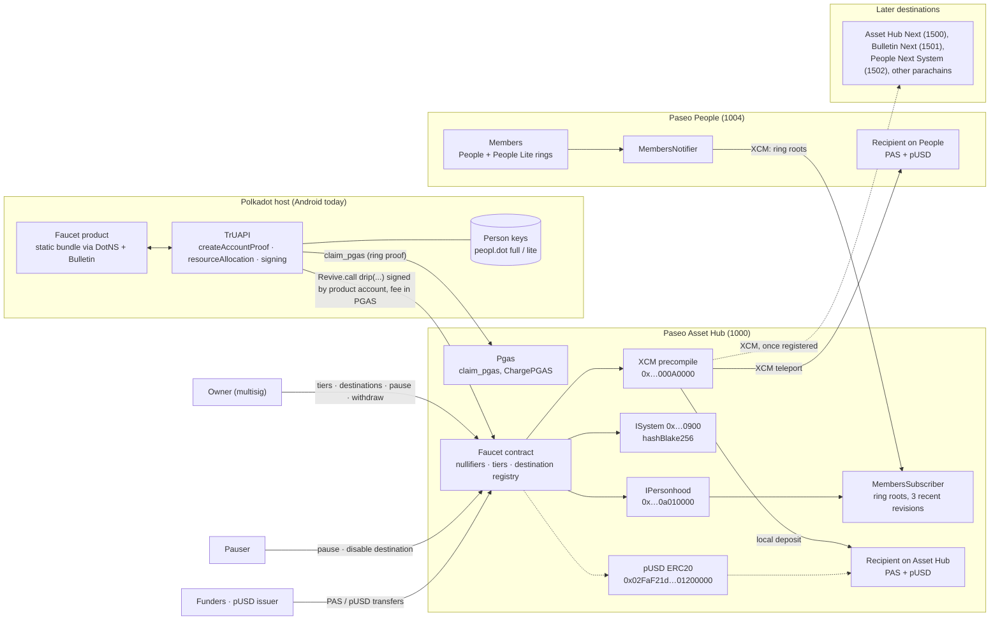
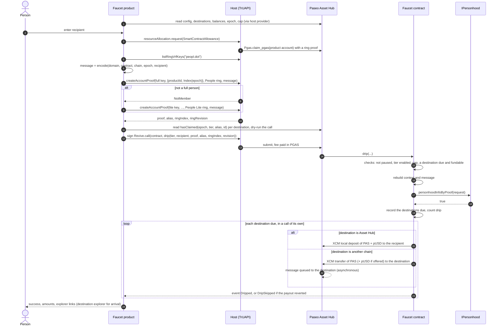
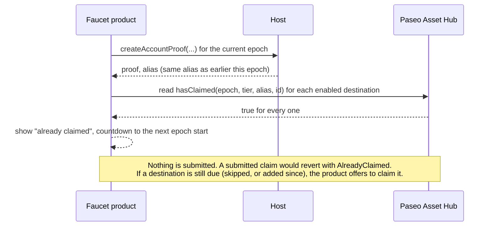
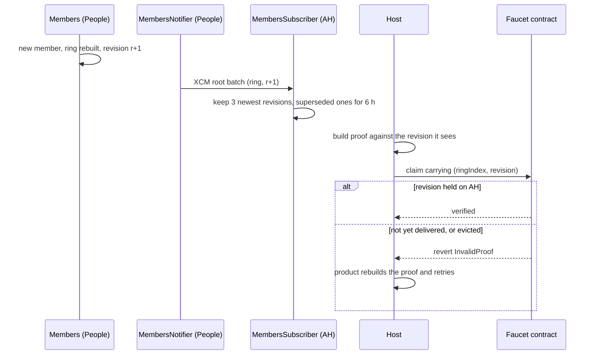
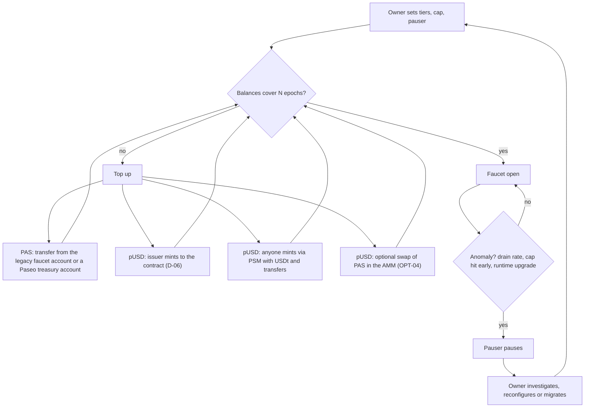
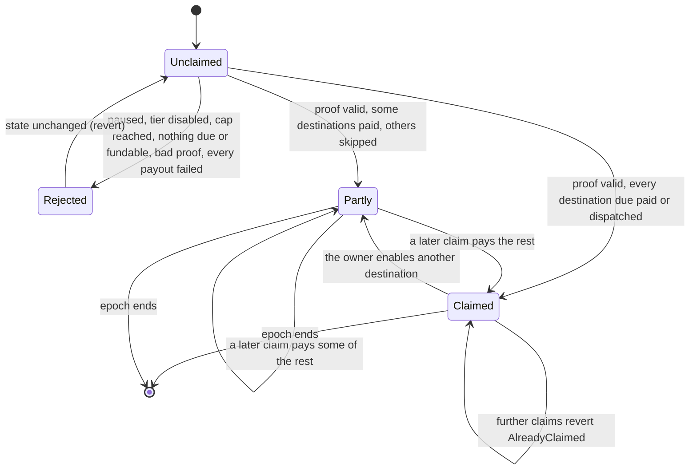
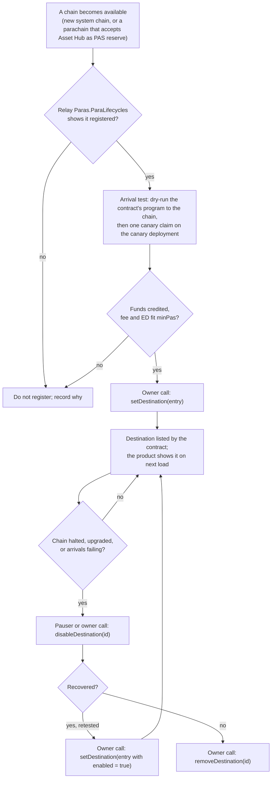

# Paseo personhood faucet: specification and architecture

**Status:** implemented in `contracts/` and checked on forks of the live Paseo runtimes
(`fork/`); not deployed. This document specifies *what* is built and *why*; the results of the
fork check and the proof spike are written back into it (sections 9 and 17). The
[README](../README.md) documents the contract as built, its deployment and its operation.
REQ-19 is specified but not yet built; [section 18](#18-remaining-work) lists all
remaining work. Facts are cited as `[Xn]` and resolved in [REFERENCES.md](REFERENCES.md); the
context behind them is in [BACKGROUND.md](BACKGROUND.md).

Requirement ids: `REQ-nn` are hard requirements (MUST), `OPT-nn` are soft requirements (SHOULD
or MAY), `D-nn` are open decisions, `SP-nn` are spikes that must pass before launch.

1. [Summary](#1-summary)
2. [Goals and non-goals](#2-goals-and-non-goals)
3. [Actors and trust](#3-actors-and-trust)
4. [Requirements](#4-requirements)
5. [Soft requirements](#5-soft-requirements)
6. [Architecture](#6-architecture)
7. [Design choices](#7-design-choices)
8. [Flows](#8-flows)
9. [Contract specification](#9-contract-specification)
10. [Product specification](#10-product-specification)
11. [Funding and economics](#11-funding-and-economics)
12. [Security and risks](#12-security-and-risks)
13. [Verification plan](#13-verification-plan)
14. [Deployment and operations](#14-deployment-and-operations)
15. [Dependencies and asks](#15-dependencies-and-asks)
16. [Open decisions](#16-open-decisions)
17. [Readiness checklist](#17-readiness-checklist)
18. [Remaining work](#18-remaining-work)

---

## 1. Summary

Replace the custodial Paseo faucet backend with:

1. a **faucet contract** on Paseo Asset Hub that holds PAS and pUSD (the Paseo counterpart of
   dotUSD) and pays both, in one transaction, to a recipient of the caller's choice, at most
   once per person, epoch and chain. Personhood is checked on chain with the `IPersonhood`
   precompile's stateless ring-proof verification [P9] [P13]. One claim pays the recipient on
   Asset Hub itself and on every other enabled chain reached by XCM: People, Asset Hub Next
   (1500), Bulletin Next (1501) and People Next System (1502) (7.9, REQ-18). The owner adds or
   removes destination chains with a contract call;
2. a **faucet product**: a static web app on DotNS and Bulletin that runs inside the Polkadot
   hosts, obtains the person's ring proof from the host, and submits the claim from its product
   account, paying fees in PGAS [T1] [T4].

No server holds funds or keys, and no server decides who is eligible. The chain side already
runs on Paseo: ring roots reach Asset Hub and ring proofs verify there (PGAS claims use them)
[E1]; on a fork, the contract half of spike SP-01 confirmed the precompile path [E7]. The
binding constraint is the hosts. Today only the Android app gives a third-party product a
personhood proof, and it does so only because it does not yet enforce TrUAPI RFC-0024's owner
allowlist [H1] [T3]. A durable faucet needs the personhood product (`peopl.dot`) to allowlist it.

## 2. Goals and non-goals

**Goals**

- **G1. No custodial backend.** Funds sit in a contract; eligibility is enforced on chain.
- **G2. Sybil resistance by personhood.** Rate-limit people, not addresses.
- **G3. Two assets per drip.** Native PAS and pUSD together, amounts configurable.
- **G4. Native to the Polkadot hosts.** Runs as a DotNS product in the Polkadot app, and in
  Polkadot Desktop and dot.li once they support it.
- **G5. Auditable and boring.** Small surface, pinned dependencies, every rule visible on chain.
- **G6. Works for users with nothing.** A person with zero PAS can claim.
- **G7. Many target chains, managed on chain.** Asset Hub, People, Asset Hub Next (1500),
  Bulletin Next (1501) and People Next System (1502) (7.9). The owner appends or removes
  destinations as chains become available or stop accepting transfers; the product reads the
  list from the contract, so no redeploy and no product release is needed.
- **G8. A shortcut for trusted users.** Accounts the owner whitelists can request a specific
  amount without a personhood proof and without waiting for the next epoch, up to a cap the
  owner sets for each of them (REQ-19).

**Non-goals**

- **N1. Matrix bot.** It needs a long-running process with an access token; it cannot be
  serverless. It stays on the legacy faucet or is retired (D-07).
- **N2. Polkadot mainnet.** Polkadot Asset Hub has no ring roots yet [E2].
- **N3. Westend and other testnets.**
- **N4. Non-persons.** Developers without a personhood are served by the legacy faucet (D-07),
  not by this contract.
- **N5. Minting.** The contract distributes what it holds; it never mints PAS or pUSD.

## 3. Actors and trust

| Actor | Role | Trust |
|---|---|---|
| Person | Lite or full member of the People collections, using a Polkadot host | untrusted; proves membership |
| Recipient | A Substrate `AccountId32` on one of the registered destination chains. Only Asset Hub has an EVM, so only there can it also be an Ethereum-derived account (`h160 ++ 0xEE…`) | none needed |
| Destination chain | A chain in the contract's destination registry, reached by XCM from Asset Hub | trusted to credit what it receives; each one is tested before it is enabled (7.9) |
| Faucet product | Static bundle at a DotNS name; builds the proof request and the claim | untrusted by the contract; the contract re-derives everything it checks |
| Product account | The person's per-product account (RFC-0022) that signs the claim and pays in PGAS [T5] | untrusted |
| Faucet contract | Holds funds, enforces the rules | the trusted code |
| Owner | The one origin for privileged calls: configures tiers and destinations, manages the whitelist (REQ-19), pauses, withdraws, transfers ownership | trusted (D-08) |
| Pauser | Can only pause the faucet or disable a destination | trusted with liveness only (OPT-06) |
| Whitelisted account | Requests specific amounts without a personhood proof or the epoch limit, up to its cap per epoch (REQ-19) | trusted by the owner up to its cap |
| Funders | Anyone sending PAS or pUSD to the contract | none needed |
| pUSD issuer | `5FX9eGJYqJTmjJDQrQpzEjGh7qQHNscW9uL1X17aXkiFN6u1` can mint pUSD [E1] | external, D-06 |
| Paseo Root (sudo) | Recognises full persons, sets the lite fee, could open alias binding | trusted: on Paseo, sudo can create persons [P7] [R17] |
| `peopl.dot` owner | Owns the person keys in the hosts; allowlists products (RFC-0024) [T3] | external dependency (A-1) |
| Hosts | Produce proofs, claim PGAS, sign | external dependency (A-2) |

The contract's security rests on: the `IPersonhood` precompile and the ring roots on Asset Hub
(People chain and XCM), the owner key, and Paseo Root. Nothing else.

## 4. Requirements

| Id | Requirement | Rationale and acceptance |
|---|---|---|
| REQ-01 | Funds are held by the faucet contract. No off-chain component holds a key that can move them, and no off-chain component decides eligibility. | G1. Acceptance: the product is a static bundle with no backend calls; the only privileged keys are owner and pauser. |
| REQ-02 | A drip requires a ring proof of membership in People (full) or People Lite, for the faucet's context, verified by `IPersonhood.personhoodInfoByProof` on Paseo AH. | G2. `personhoodStatus` cannot be used on Paseo: alias binding is closed [R6] [E1]. |
| REQ-03 | At most one drip per person per tier per epoch on each destination. The nullifier is the contextual alias returned by the proof; it is recorded for each destination before any payout. | G2. The alias is unique per person per context [P3]. The precompile keeps no nullifier [P13]. |
| REQ-04 | The proof's `message` commits to the domain, the contract, the chain, the epoch and the recipient. The contract rebuilds `message` from the call arguments and never accepts it from the caller. | The precompile does not bind `msg.sender` [P9]. Without this, a copied proof could redirect the drip to another account. Acceptance: a valid proof replayed with another recipient or epoch fails. |
| REQ-05 | One claim pays, on each destination, a configured PAS amount and, where the destination supports it, a configured pUSD amount for the caller's tier, in the same transaction. A destination whose payout fails on Asset Hub is skipped and its nullifier is not consumed; a claim that pays nothing reverts. | G3, D-12. Delivery to another chain is asynchronous (7.9). |
| REQ-06 | The recipient is a 32-byte `AccountId32` on every destination, existing or not. On Asset Hub it may be mapped to an H160 or not, Substrate or Ethereum-derived (`0xEE` form); Asset Hub is the only destination with an EVM, so it is the only one where an H160 is meaningful. | Developers bring old Substrate accounts (unmapped [S4]) and Ethereum addresses. Acceptance: SP-02 cases all receive both assets. |
| REQ-07 | A person with no PAS can claim. The claim is a Substrate-signed `Revive.call` from the product account, payable in PGAS; it carries no value; per-claim storage is bounded. | G6. PGAS pays `Revive` calls and deposits [R4]; Ethereum-signed transactions cannot use PGAS. |
| REQ-08 | Outflow is bounded: a global cap per epoch on the number of drips, a pause switch, and explicit withdrawals only by the owner. | Bounds the damage from sybils (section 11), host bugs and contract bugs. |
| REQ-09 | Amounts per tier, tier enablement and the epoch cap are configurable without redeploying. The epoch length and the product identity are fixed at deployment. | Changing the epoch length or the product id mid-life would re-key nullifiers. |
| REQ-10 | Every drip and every configuration change emits an event. Configuration, balances, the current epoch, the next epoch start, and whether an alias has claimed are readable on chain. | G5. The product needs them, and they make the faucet auditable without an indexer. |
| REQ-11 | The context and message formats in section 9 are normative. Contract and product implement them byte for byte, and the spec carries test vectors. | A one-byte mismatch fails every proof. |
| REQ-12 | The contract is not upgradeable, has no delegate calls and no self-destruct, and follows checks, effects, interactions. | G5. A new version is a new deployment (section 14). |
| REQ-13 | Source is verified on the Paseo AH explorer, and the build is reproducible from a tagged commit. | G5. |
| REQ-14 | The product works in at least one shipping host at launch (Android), detects unsupported hosts, and points their users to the fallback (D-07). | G4. Proofs are Android-only today [H1] to [H4]. |
| REQ-15 | The product talks only to the host (chain access, signing, proofs). It makes no calls to any backend and embeds no secret. | G1. |
| REQ-16 | The contract keeps a destination registry. The owner adds, updates and removes destinations with contract calls; the pauser can disable one. Only enabled destinations are paid. The launch set is Asset Hub (local), People (1004), Asset Hub Next (1500), Bulletin Next (1501) and People Next System (1502). The built contract registers Asset Hub and People; the other three join after their entries are measured and they pass an arrival test (section 18). | G7. Acceptance: adding a destination makes it appear in the product with no product release; removing or disabling it stops payouts to it. |
| REQ-17 | A destination entry holds typed fields only (section 9.2). The contract builds the XCM program for a destination from those fields; it never executes XCM bytes supplied by the owner or the caller. | Keeps every possible payout auditable: a destination entry can only move the drip amounts to the recipient on that chain. |
| REQ-18 | One claim pays the recipient on every enabled destination at once: PAS everywhere, and pUSD where the destination takes it. A destination that cannot be paid (the tier's PAS is below its minimum, the faucet lacks the PAS, the payout fails on Asset Hub) is skipped, one whose pUSD cannot be paid gets PAS only, and the person receives the rest. A skipped destination can be claimed again in the same epoch. | D-12, D-16. The proven message names no destination (9.5); a claim that can pay nothing reverts, so the nullifier is not spent; each skipped destination emits `DripSkipped` with the reason. Acceptance: `req18` in [E6]. |
| REQ-19 | The owner keeps a whitelist of accounts. A whitelisted account requests specific PAS and pUSD amounts for a recipient on enabled destinations, without a personhood proof and without the per-person epoch limit; its total per epoch stays within a PAS cap and a pUSD cap the owner sets for it. Adding, changing and removing entries emits events. | G8. Not built yet (D-15). The cap bounds what a leaked whitelisted key can take before the owner removes it; requests stop while the faucet is paused. |

## 5. Soft requirements

| Id | Level | Requirement | Notes |
|---|---|---|---|
| OPT-01 | SHOULD | Tiered amounts: full persons receive more than lite persons. | Full personhood on Paseo is granted by sudo only [E1]; lite is cheap (section 11). |
| OPT-02 | SHOULD | Per-epoch contexts, so a person's claims in different epochs are unlinkable. | Section 7.3. Costs one new storage item per claim, 0.00264 PAS of deposit (9.9). |
| OPT-03 | MAY | Further destinations through the same registry, after launch: the relay chain (today's faucet serves it, but it is not in the launch set) and non-system parachains that accept Asset Hub as the reserve for PAS. | 7.9. Each is added by an owner call after its own arrival test; no contract change. |
| OPT-04 | MAY | Top up pUSD by swapping PAS through the asset-conversion precompile, within a slippage bound and a daily cap. | The idea of "swapping on request from the assets the faucet already holds". It moves the shared PAS/pUSD pool, so not the primary source (D-06). |
| OPT-05 | MAY | A recipient balance cap like today's 5500 PAS rule. | Less useful once people are rate-limited, and native balances of unmapped accounts are not readable from a contract. |
| OPT-06 | SHOULD | A separate pauser role that can pause but not unpause, configure or withdraw. | Lets a monitoring operator react without holding the owner key. |
| OPT-07 | MAY | A stats view in the product (drips this epoch, budget left), computed from events and state. | No indexer required. |
| OPT-08 | SHOULD | iOS, Polkadot Desktop and dot.li support as soon as their hosts serve allowlisted proofs. | Depends on A-1 and A-2. |
| OPT-09 | SHOULD | The legacy faucet keeps serving non-persons and Matrix, with lower amounts, until the product covers the hosts developers use. | D-07. |
| OPT-10 | MAY | Accept an account already bound to the faucet context (`personhoodStatus`) instead of a proof, if Paseo ever opens alias binding. | Cheaper per claim; needs Root to set `AliasFee` [R6] and suffers the one-binding-per-account limit [P11]. Not for v1. |
| OPT-11 | MAY | Remember the last recipient in the product (host local storage). | Convenience only. |
| OPT-12 | SHOULD | Before a cross-chain claim, the front-end dry-runs the forwarded XCM on the destination (`DryRunApi`) and warns if it would not credit the recipient. | 6.1. Needs the host to reach the destination chain; skipped silently where it cannot. |

## 6. Architecture



Components:

| Component | Responsibility | Lives at |
|---|---|---|
| Faucet product (front-end) | Detect host, read faucet state, request PGAS, obtain proof, build and submit the claim, show results (split in 6.1) | DotNS name (D-01), Bulletin |
| Faucet contract | Verify proof, enforce nullifier and caps, keep the destination registry, pay PAS and pUSD, expose state | Paseo AH, pallet-revive |
| `IPersonhood` | Verify the ring proof against roots held on AH | runtime precompile [R5] |
| `ISystem` | `hashBlake256` to derive the context on chain [S1] | runtime precompile |
| XCM precompile | Deposit PAS and pUSD to any `AccountId32` on Asset Hub, and send them to other chains [S3] | runtime precompile |
| Destination chains | Credit the recipient: People at launch | Paseo system parachains |
| pUSD ERC20 | Read the contract's pUSD balance; direct transfers in the fallback payout path [S2] | runtime precompile |
| Pgas | Free fee token for persons [P8] | runtime pallet |
| Legacy faucet | Non-persons, Matrix (D-07) | existing deployment [F1] |

### 6.1 Contract and front-end split

The faucet product is the front-end of the contract. The rule for placing logic: **anything
that protects funds or eligibility is enforced by the contract; everything else lives in the
front-end.** Front-end checks are advisory. They save people a failed transaction, and the
contract re-checks whatever matters.

| Logic | Contract | Front-end | Why |
|---|---|---|---|
| Personhood proof | verifies it (`personhoodInfoByProof`) | obtains it from the host, tries the full key then the lite key, adds the compact length prefix (9.6) | only the verification is security relevant |
| Context and message | rebuilds both from the call arguments (9.4, 9.5) | computes the same bytes to request the proof; cross-checks against `contextFor` and `messageFor` | the contract must never trust a caller-supplied message (REQ-04) |
| Nullifier and caps | enforces one payout per person, epoch and destination, and the epoch cap | reads `hasClaimed` per destination and `dripsInEpoch` to show status and countdowns | enforcement is on chain; the read avoids wasted claims |
| Tier | checks the proof against the requested tier | picks the tier from which key proved | |
| Destination | pays every enabled one; builds the XCM program from the typed entry (REQ-17) | renders the list from `destinations()`; carries display names and explorer links per para id | the program must not come from the caller |
| Recipient | treats it as an opaque `AccountId32` | parses SS58 of any prefix to 32 bytes; also accepts an H160 and converts it to the `0xEE` form, warning that only Asset Hub can use it (K-27) | parsing is formatting, not a security decision; a wrong but well-formed account only hurts its submitter |
| Amounts and fees | applies the tier amounts and `remoteFee`; skips a destination whose `minPas` the tier's PAS does not reach | shows the net amount per destination; may estimate fees with `XcmPaymentApi` to help the owner set `remoteFee` | |
| Pre-flight | none | dry-runs the claim on Asset Hub (`ReviveApi.call`) and, where the host can reach the destination, dry-runs the forwarded XCM there (OPT-12) | catches a rejecting destination before the person spends their claim (K-16) |
| Fees for the claimant | none | requests PGAS through the host when the product account lacks it | |
| Stats | emits events | aggregates events for OPT-07 | no indexer |

## 7. Design choices

### 7.1 Which personhood check

| Option | Works on Paseo today | Per-claim cost | Notes |
|---|---|---|---|
| **A. `personhoodInfoByProof` (recommended)** | yes | about 20 ms of ref time, about 0.009 PAS [R7] | Stateless; the contract owns the nullifier and the message binding. |
| B. `personhoodStatus(account, context)` | no: `AliasFee` unset, 0 bindings [R6] [E1] | about 0.13 ms | Needs Root to open binding, a paid `set_alias_account` per account, and an account can hold one binding only [P11]. RFC-0024 also flags that the pallet accepts any context [T3]. |

Option A needs no chain change and is what the precompile documents for contracts that need
"verification tied to a specific account" [P9]. Option B stays a later optimisation (OPT-10).

### 7.2 The context

The context must be the faucet product's own context, because hosts only derive
`blake2b_256("product/" ++ productId ++ "/" ++ idx32(suffix))` and a product proving under
another product's id is either prompted or refused [T3] [H1]. Consequences:

- The contract fixes `productId` at deployment (REQ-09) and must equal the DotNS name the
  product is served from (D-01). Renaming the product means redeploying the contract.
- The runtime appends `NETWORK_SUFFIX` (`dot` on Paseo) to the product name [R8]. If Root ever
  changes the suffix, hosts would derive a different context and every proof would fail (risk
  K-07).

### 7.3 Fixed or per-epoch context (OPT-02, D-04)

| | Fixed context (`Index(0)`) | Per-epoch context (`Index(epoch)`, recommended) |
|---|---|---|
| Alias | one per person, forever | one per person per epoch |
| Linkability | all claims of a person (and their recipients) are linked by the alias | claims in different epochs are unlinkable |
| Nullifier storage | one item per person, overwritten (last epoch claimed) | one new item per claim |
| Storage deposit | 0.00264 PAS-equivalent once per person, paid in PGAS | 0.00264 PAS per claim [E7] [R23], paid in PGAS [R4]; never released, because claim records are kept |
| Contract work | none | derive the context with `ISystem.hashBlake256` each claim |

The per-epoch option keeps the faucet consistent with the purpose of contextual aliases. Its
extra deposit is paid in PGAS, which persons claim for free. The decision is D-04.

### 7.4 Payout path (D-05)

A contract can pay an `AccountId32` directly only through its H160, and that works only if the
account is mapped or Ethereum-derived [S4]. Many Paseo accounts predate AutoMap, and a fresh
recipient has no mapping yet. A direct value transfer to a non-existent account also pulls the
ED from the signer in native PAS [S5].

| Option | How | Reaches | Cost and risk |
|---|---|---|---|
| **P1. XCM deposit (recommended; SP-02 passed [E6])** | One local XCM program through the XCM precompile: withdraw PAS and pUSD from the contract, deposit both to `AccountId32(recipient)` | every recipient, including new and unmapped accounts; extends to OPT-03 | one more precompile and a SCALE-encoded message in the contract; behaviour from a contract origin verified on a fork by SP-02 [E6] |
| P2. Direct transfers | value transfer plus ERC20 `transfer` to the recipient's H160, after checking with `ISystem.toAccountId` that it maps back to the recipient (or that the recipient is `0xEE`-suffixed) | mapped and Ethereum-derived accounts only; others are rejected and asked to map | standard Solidity, cheapest; violates REQ-06 for unmapped accounts |

P1 meets REQ-06 with a single code path, and it is the same mechanism that reaches other chains
(7.9). P2 was the fallback had SP-02 shown contract-originated XCM execution not viable; SP-02
passed [E6], so the contract implements P1.

### 7.5 Signing and fees

The claim is a Substrate-signed `Revive.call` from the person's product account. Fees and the
nullifier deposit are paid in PGAS through `ChargePGAS` and `PGasDeposit` [R4]. The product
requests PGAS with `resourceAllocation.request([SmartContractAllowance])` [T4]; Android also tops
it up automatically for `Revive`-only transactions [H5]. Ethereum-signed transactions are out of
scope because they cannot pay in PGAS and hosts expose no Ethereum signing [T1].

### 7.6 Tiers

The contract accepts both collections (`expectedStatus` 1 and 2) with separate amounts. A human
holding both a full and a lite key gets one alias per key and so can claim in both tiers
(K-02). Accepting only one tier removes that but excludes the other group (D-03).

### 7.7 Upgrades

No proxy (REQ-12). A new version is a new contract: the owner pauses the old one and withdraws
its balances (`withdraw` pays the owner), funds the new one, and the product switches address.
Nothing needs migrating. Claim records do not carry over, so a person who claimed on the old
contract in the epoch of the switch could claim once more on the new one; switching at an epoch
boundary avoids it.

### 7.8 Toolchain (D-09)

Paseo AH accepts both EVM bytecode (solc) and PolkaVM (resolc, Rust) [R13]. Solidity compiled to
EVM bytecode with Foundry is the most auditable choice and is already used for contracts
deployed on Paseo AH (DotNS). Precompile calls behave the same either way.

### 7.9 Destinations

**Mechanism.** The XCM precompile lets the contract execute an XCM v5 program as itself
(`execute(message, weight)`); there is no `transfer_assets` helper, so the contract builds the
program [S3]. Asset Hub allows any signed origin to execute, teleport and reserve-transfer
[R19]. The contract pays the delivery fee from its own PAS (only system origins are exempt), at
most the entry's `maxDeliveryFee`: a payout that takes more than the PAS amount plus
`maxDeliveryFee` is undone and skipped, and the destination stays claimable [E6]. The destination's
execution fee comes out of the dripped PAS, and `RefundSurplus` returns the unspent part of
`remoteFee` to the recipient (9.10).

**What decides the transfer type** is the trust between Asset Hub and the destination, not the
contract [S7] [R18]:

| Destination | PAS | pUSD | Notes |
|---|---|---|---|
| Asset Hub (1000), local | local deposit | local deposit | launch set; 7.4 |
| People (1004) | teleport | teleport only; People accepts pUSD solely as a teleport from Asset Hub [R21] [R18] | launch set; today's faucet teleports PAS here [F5] |
| Asset Hub Next (1500) | to determine | yes; transfer kind to determine | launch set; transfer kinds, fees and minimums come from an arrival test (section 18) |
| Bulletin Next (1501) | to determine | no | launch set; PAS only |
| People Next System (1502) | to determine | yes; transfer kind to determine | launch set; transfer kinds, fees and minimums come from an arrival test (section 18) |
| Relay chain (OPT-03) | teleport | not possible | not in the launch set; can be registered later |
| Non-system parachain (OPT-03) | reserve transfer, Asset Hub holds the reserve | reserve transfer, if the chain registered pUSD | the chain must accept Asset Hub as the PAS reserve and have an HRMP channel with Asset Hub; Asset Hub has channels with 16 non-system parachains [E4], but the channels predate the relay relaunch and only 3345, 3377 and 4009 of them are registered on the relay [E6] |

**Where pUSD applies.** Asset Hub Next (1500) and People Next System (1502) also receive pUSD;
how they hold it is determined with their arrival tests (section 18). On the live chains pUSD is
meaningful in two places:

- **Asset Hub**, where it lives (asset `50000413`): the PSM, the PAS/pUSD pool and contracts use
  it there [E1].
- **People**, where it is the chain's "external asset": a local `Assets` entry at the Asset Hub
  location `(1, Parachain(1000), PalletInstance(50), GeneralIndex(50000413))`, named "Digital
  Dollar" [R22] [E5]. Coinage, proof of ink, scores and mob rule use it as their currency, and
  it can pay People transaction fees [R21]. Its minimum balance on People is 10,000 base units
  (0.01 pUSD), against 10 on Asset Hub [E5].

A chain that does not hold pUSD gets PAS only. The registry encodes this: `pusdTransfer` is
`Local` for Asset Hub, `Teleport` for People and `None` for a PAS-only destination.

**Registry entry** (typed fields only, REQ-17):

| Field | Meaning |
|---|---|
| `id` | the destination's para id (`1000` for local delivery; the relay's reserved id is `0`) |
| `enabled` | claims to it are accepted |
| `pasTransfer` | `Local`, `Teleport` or `ReserveFromAssetHub` |
| `pusdTransfer` | `None`, `Local`, `Teleport` or `ReserveFromAssetHub` |
| `remoteFee` | PAS budget for the destination's execution fee, taken from the drip; `RefundSurplus` returns the unspent part to the recipient |
| `maxDeliveryFee` | the most the faucet pays Asset Hub to deliver one drip there, in plancks: 0 for Asset Hub, above 0 for every other entry |
| `minPas` | the destination's existential deposit plus `remoteFee`; a tier amount below it cannot be sent there. `minPas` above `remoteFee` applies to Asset Hub too, so its `minPas` is above 0 |
| `minPusd` | the destination's pUSD minimum balance (10 base units on Asset Hub, 10,000 on People); zero exactly when `pusdTransfer` is `None` |

There is no account-format field: the beneficiary is always `AccountId32(recipient)`, because
every destination other than Asset Hub is a Substrate chain without an EVM.

**Managing destinations.** The owner adds or updates an entry with `setDestination` and deletes
it with `removeDestination`. The pauser can only call `disableDestination`, to stop claims to a
chain that is halted or misbehaving; only the owner re-enables. Every change emits an event.
The product renders the destination list from the contract (10.2), so a new chain becomes
available to people as soon as the owner adds it.

**Delivery is asynchronous.** For any destination other than Asset Hub the claim succeeds once
the message leaves Asset Hub. If the destination rejects it (untrusted reserve, fee too low,
amount below its existential deposit) the funds are stuck there and the person's claim on
that destination is already spent. That is why a destination is enabled only after an arrival test (14, SP-04), and
why the product shows a "check arrival" link to the destination's explorer.

**Per-person limit.** One payout per person per epoch on each destination, which matches
today's per-address quota (D-11). One claim pays every enabled destination; a later claim in
the same epoch pays only the destinations still due, those skipped or added since.

## 8. Flows

### 8.1 First claim (happy path)



### 8.2 Repeat claim in the same epoch



### 8.3 Ring roots and proof freshness



### 8.4 Funding and operations



### 8.5 Claim states for one alias in one epoch



### 8.6 Adding, disabling and removing a destination



The first gate is the relay's registration. HRMP channels and `PolkadotXcm.SupportedVersion` on
Asset Hub are not evidence that a chain is live: Asset Hub still holds both for paras that are
no longer registered on the relay [E6].

## 9. Contract specification

This section fixes behaviour and formats, not code.

### 9.1 Fixed at deployment

| Name | Value |
|---|---|
| `PRODUCT_ID` | the DotNS name the product is served from, for example `faucet.dot` (D-01) |
| `EPOCH_SECONDS` | epoch length, for example 86,400 (D-03) |
| `DOMAIN` | ASCII `paseo-faucet:v2` |
| Precompile addresses | `IPersonhood` `0x000000000000000000000000000000000a010000`, `ISystem` `0x0000000000000000000000000000000000000900`, XCM `0x00000000000000000000000000000000000A0000`, pUSD ERC20 `0x02FaF21d00000000000000000000000001200000` |

### 9.2 Configurable by the owner

Per tier (lite, full): `enabled`, `pas` (in plancks, a multiple of `10^8` wei so no dust
arises [S5]), `pusd` (base units; each destination's `minPusd` applies at claim time). Global:
`maxDripsPerEpoch`, `paused`, `pauser`. Ownership moves in two steps (propose, accept).

Destination registry: a map from destination id to the entry in 7.9, plus the list of ids in
the order they were first registered, so the product can enumerate it. An id keeps its place
after removal, because its index is its bit in the claim record (9.7); at most 256 ids can ever
be registered. Launch entries, in plancks and pUSD base units:

| id | Chain | `pasTransfer` | `pusdTransfer` | `remoteFee` | `maxDeliveryFee` | `minPas` | `minPusd` |
|---|---|---|---|---|---|---|---|
| 1000 | Asset Hub (local) | `Local` | `Local` | 0 | 0 | 1e8 (the existential deposit) | 10 |
| 1004 | People | `Teleport` | `Teleport` | 1e8 (0.01 PAS) | 5e9 (0.5 PAS) | 1.1e9 (existential deposit 1e9 + `remoteFee`) | 10,000 |

The values are `launch()` in `contracts/script/Deploy.s.sol`, measured in [E6]
(`launchEntries`): People's `remoteFee` is 31 times its measured execution fee and its
`maxDeliveryFee` 16 times its measured delivery fee. Entries for Asset Hub Next (1500), Bulletin
Next (1501) and People Next System (1502) are added once measured (section 18). The relay chain
is not in the launch set.

### 9.3 Epoch

`epoch = floor(block.timestamp / EPOCH_SECONDS)`. In pallet-revive `block.timestamp` is in
seconds [S6]. The next epoch starts at `(epoch + 1) * EPOCH_SECONDS`.

### 9.4 Context (normative)

```
INDEX_MAGIC = blake2b_256("product-account-index")[0..28]
            = 12e86013736c5498f050b03cdc16957dff0e422fb92ca77ec3ab168f
suffix      = u32_le(n) ++ INDEX_MAGIC          n = epoch (per-epoch, D-04) or 0 (fixed)
context     = blake2b_256("product/" ++ PRODUCT_ID ++ "/" ++ suffix)
```

This equals the host derivation for `ProductProofContext { productId: PRODUCT_ID, suffix:
Index(n) }` and the runtime's `build_product_context` [P15] [R8]. Test vectors are in
[REFERENCES.md](REFERENCES.md#computed-values).

### 9.5 Message (normative)

```
message = DOMAIN                (15 bytes, ASCII "paseo-faucet:v2")
       ++ contract address      (20 bytes)
       ++ chain id              (8 bytes, u64 big-endian, 420420417 on Paseo AH)
       ++ epoch                 (8 bytes, u64 big-endian)
       ++ recipient             (32 bytes, the AccountId32)
                                 = 83 bytes
```

The chain id alone is not a unique domain on Polkadot test networks, so the contract address
is included as well. A claim pays every enabled destination, so there is no destination to
bind (D-16). The epoch duplicates what the per-epoch context (9.4) already binds; it stays, for
8 bytes, so the binding does not depend on the context choice. The product signs exactly these
bytes; the contract rebuilds them. The message never travels on chain, so its length does not
affect fees.

The contract before REQ-18 signed `paseo-faucet:v1` with a 4-byte destination id before the
recipient, 87 bytes. The domain's version changed with the format, so a message in one format
can never verify as the other.

### 9.6 Proof encoding

Hosts return the raw proof (785 bytes for one context); the precompile expects the SCALE
`BoundedVec<u8>` encoding, that is, a compact length prefix in front [P14] [T1]. The front-end
adds the prefix and the contract forwards the bytes unchanged. A wrong encoding is not a
safety issue: the precompile rejects anything over its bound (1267 encoded bytes) before
decoding and returns `false` for anything that does not decode, so the claim reverts with
`InvalidProof`. The format is still normative and has test vectors (REQ-11). On the real
precompile, the SCALE form (compact(785) = `0x450c` followed by the 785 bytes, 787 bytes in
all) verifies, and the raw 785 bytes make the claim revert `InvalidProof` [E7].

### 9.7 Operations

| Operation | Who | Behaviour |
|---|---|---|
| `drip(tier, recipient, proof, alias, ringIndex, revision)` | anyone | A destination is *due* when it is enabled and has not paid `(epoch, tier, alias)`. In order: not paused; tier enabled; if the alias has no payout this epoch, drips this epoch below the cap; some destination due (`AlreadyClaimed`, or `NothingToPay` when the alias has no payout this epoch); some due destination fundable: tier PAS amount at least its `minPas` and spendable PAS covering the amount plus its `maxDeliveryFee` (`NothingToPay`); build context and message; `personhoodInfoByProof` returns true; record every due destination as paid and, if the alias had no payout this epoch, increment the epoch count; then pay each due destination in registry order, skipping one whose `minPas` the amount does not reach (`BelowMinimum`) or that the faucet cannot fund at that point (`InsufficientPas`), and otherwise running its program (9.10) through `payLeg`, which reverts `PayoutFailed` if it took more than the PAS amount plus `maxDeliveryFee` and is then skipped (`PayoutFailed`). A payout carries pUSD where the destination takes it, the tier amount reaches its `minPusd` and the faucet holds it. Emit `Dripped` per destination paid and `DripSkipped` per destination skipped, and clear the record of the skipped ones. If none was paid, revert `PayoutFailed`. Not payable: attached value reverts with empty data. |
| `payLeg(entry, recipient, pas, pusd)` | the faucet only | Runs one destination's program as a separate call, so that its failure reverts only that payout. Anyone else gets `NotSelf`. |
| `currentEpoch()`, `nextEpochStart()` | view | |
| `contextFor(epoch)`, `messageFor(epoch, recipient)` | view | Let the product and auditors check the formats against the contract itself. |
| `hasClaimed(epoch, tier, alias, id)`, `dripsInEpoch(epoch)` | view | `hasClaimed` is per destination. |
| `tiers(tier)`, `maxDripsPerEpoch()`, `paused()`, `pauser()`, `owner()`, `pendingOwner()`, `balances()` | view | Public getters instead of a `config()` aggregate. `balances()` returns spendable PAS in plancks (the free balance minus the existential deposit) and pUSD in base units. |
| `destinations()`, `destination(id)` | view | The registered entries in the order their ids were first registered, as the product renders them. `destination(id)` returns a flat 8-field tuple, all zeros for an unknown id. |
| `setTier`, `setMaxDripsPerEpoch`, `setPauser`, `unpause` | owner | Each emits an event. |
| `setDestination(entry)`, `removeDestination(id)` | owner | Add, update (including re-enabling) or delete a destination. |
| `disableDestination(id)` | owner or pauser | Stops claims to one chain. |
| `pause` | owner or pauser | Emits `Paused`. |
| `withdraw(pas, pusd)` | owner | Pays the caller, the owner, with plain transfers independent of XCM; a zero amount skips that asset. Explicit, evented; the only way funds leave other than drips. |
| `transferOwnership`, `acceptOwnership` | owner, then new owner | Two-step. |
| Receiving PAS and pUSD | anyone | Plain transfers to the contract's account. |

### 9.8 Events and errors

Events: `Dripped(epoch, tier, contextAlias, destinationId, recipient, pas, pusd)` (`pas` is the
gross amount), `DripSkipped(epoch, tier, contextAlias, destinationId, recipient, reason)`
(`reason` is `BelowMinimum`, `InsufficientPas` or `PayoutFailed`), `TierUpdated`,
`EpochCapUpdated`, `DestinationSet`, `DestinationDisabled`, `DestinationRemoved`, `Paused`,
`Unpaused`, `PauserUpdated`, `Withdrawn(to, pas, pusd)` (`to` is the owner),
`OwnershipTransferStarted`, `OwnershipTransferred`.

Errors: `FaucetPaused`, `TierDisabled`, `UnknownDestination`, `EpochCapReached`,
`AlreadyClaimed`, `NothingToPay`, `InvalidProof`, `PayoutFailed`, `NotOwner`, `NotPauser`,
`NotSelf`, `InvalidConfig`.

`FaucetPaused` is named apart from the `Paused` event, because Solidity cannot give an error
and an event the same name. There is no `ValueNotAccepted`: `drip` is not payable.
`InvalidConfig` rejects an empty `productId` or a zero `epochSeconds`, `setTier` for `None`,
destination entries that break the 7.9 rules, and a 257th destination id. The alias is named
`contextAlias` in `drip`, `hasClaimed`, `Dripped` and `DripSkipped`, because `alias` is reserved
in Solidity. If `weighMessage` reverts, which only an undecodable program causes, that payout is
skipped like any other `PayoutFailed`.

### 9.9 Expected cost of one claim

| Part | Measured | Source |
|---|---|---|
| Proof verification | 20,089,078,000 ref time and 4,470 proof size, about 0.009 PAS | [R7], [E7] |
| Claim paying Asset Hub and People, without the proof check | dry run 12,698,159,195 ref time and 632,517 proof size; fee 70,960,246 plancks (0.0071 PAS), paid in PAS | [E6] `req18` |
| Later claim paying one skipped destination (People), without the proof check | 8,348,633,036 ref time and 471,975 proof size; fee 56,654,456 plancks | [E6] `req18` |
| Rejected claim (`InvalidProof`) | 21,763,008,689 ref time and 272,046 proof size, paid by the signer | [E6] `dripWithEmptyProof` |
| Claim before REQ-18, one destination (Asset Hub), real proof | dry run 24,799,871,624 ref time and 238,759 proof size; 25,923,767,624 ref time when included; fee 84,240,636 plancks (0.0084 PAS) | [E7] |
| Storage deposit | 26,400,000 plancks (0.00264 PAS) per claim record, one slot per epoch, tier and alias whatever the number of destinations (`DepositPerChildTrieItem` 2e7 plus 64 bytes at `DepositPerByte` 1e5), and the same once per epoch for `dripsInEpoch`: 52,800,000 on an epoch's first claim; a later claim of skipped destinations adds none | [E6] [E7] [R23] |
| Payout XCM weight | 2,958,132,000 ref time on Asset Hub with pUSD; 5,005,332,000 to People | [E6] |
| Delivery fee (other chains) | 306,150,000 plancks (0.0306 PAS) to People, paid by the contract, at most `maxDeliveryFee` | [E6] |
| Destination execution fee | 3,168,127 plancks on People, taken from the dripped PAS | [E6] |
| Total for the claimant | for Asset Hub and People, about 0.0071 PAS in fees plus the proof check's 0.009 PAS, and 0.00264 to 0.00528 PAS of deposit; payable in PGAS (5 PGAS per PGAS claim [E1]) if SP-03 passes | [E6] [E7] |

Proof size is what grows with the registry. Each contract storage read on Asset Hub is charged
about 10 KB of proof size [R24] [S9], and a claim reads the `enabled` flag of every registered
id and the whole entry of every destination it pays. The two-destination claim above takes
about 6% of the 10 MiB an Asset Hub block can prove [R25] [S10], so a claim on the full launch
set still leaves room for several claims per block.

### 9.10 XCM programs (normative structure)

For each destination a claim pays, the contract builds one of these programs from the entry
and executes it through `payLeg`, a call of its own, so that a failure reverts only that
payout [S8]. The structure is
normative and the bytes are test vectors (REQ-11): seven golden programs in
`contracts/test/XcmProgram.t.sol` (also in [REFERENCES.md](REFERENCES.md#computed-values)), and
the 11 programs in `programs[]` of [E6], captured from the deployed contract and decoded by
Asset Hub's own codec.

| `pasTransfer` / `pusdTransfer` | Program executed by the contract on Asset Hub |
|---|---|
| `Local` / `Local` or `None` | `WithdrawAsset(assets)`, `DepositAsset { assets: Wild(AllCounted(n)), beneficiary: AccountId32(recipient) }` |
| `Teleport` or `ReserveFromAssetHub` / `None`, `Teleport` or `ReserveFromAssetHub` | `WithdrawAsset(assets)`, `SetFeesMode { jit_withdraw: true }`, `InitiateTransfer { destination, remote_fees: <PAS kind>(Definite([remoteFee in PAS])), preserve_origin: false, assets: [<PAS kind>(Definite([PAS less remoteFee])), <pUSD kind>(Definite([pUSD]))?], remote_xcm: [RefundSurplus, DepositAsset { assets: Wild(AllCounted(n)), beneficiary: AccountId32(recipient) }] }` |

`assets` lists pUSD before PAS, because XCM decodes only sorted assets, and `n` is their count
(1 or 2). `<kind>` is `Teleport` or `ReserveDeposit`. `SetFeesMode` makes the contract's account
pay the delivery fee: `InitiateTransfer` empties holding first, so without it the transfer
fails with `NotHoldingFees`. `RefundSurplus` hands the unspent part of `remoteFee` to the
recipient; without it the destination traps it.

Mixed entries (for example PAS by reserve and pUSD by teleport, a golden vector to 2034) are one
`InitiateTransfer` with one transfer filter per asset, which XCM v5 allows.

## 10. Product specification

### 10.1 Screens and states

| State | Shown when | Content |
|---|---|---|
| Unsupported host | not in a host, or the host refuses the proof (`NotAllowlisted`, unsupported call) | what the faucet is, which hosts work, link to the fallback faucet (D-07) |
| Not a person | both keys return `NotMember` | how to become a lite person in the Polkadot app; link to the fallback |
| Ready | eligible this epoch | the enabled destinations from the contract, Asset Hub first, with the amounts for the tier on each (PAS less the destination's execution fee, which is at most `remoteFee`; pUSD only where offered), faucet balances, recipient field (an SS58 address of any prefix; also a `0x` H160, converted to the `0xEE` form, with a warning that only Asset Hub can use it), "Claim" |
| Already claimed | `hasClaimed` true for every enabled destination | time to the next epoch |
| Faucet empty or capped | the dry run reverts `NothingToPay` or `EpochCapReached` | when the cap resets; no submission |
| Paused | `paused` | notice only |
| In progress | after signing | broadcast, included, finalized; explorer link |
| Done | `Dripped` seen | amounts per destination, recipient; Asset Hub explorer link, and for other chains a link to check arrival on the destination's explorer; for each `DripSkipped`, the reason and that it can be claimed again this epoch |
| Failed | revert or proof rejection | the decoded error; for `InvalidProof`, one automatic retry with a fresh proof (8.3) |

### 10.2 Behaviour

- Reads chain state only through the host provider; no RPC URLs, no backend (REQ-15).
- Builds the destination list from `destinations()` on every load; it holds no hardcoded list,
  so destinations the owner adds or removes show up without a product release (G7). Display
  names and explorer links per para id are the only static data the product carries, with a
  generic fallback for an id it does not know.
- Uses the `product-sdk` line whose TrUAPI wire matches the target hosts [T7].
- Tries the full key first, then the lite key; never hardcodes key indexes, selects keys by
  declared ring as RFC-0024 asks [T3] [T2].
- Dry-runs the call before asking the user to sign.
- Requests PGAS only when the product account lacks it.
- Shows the exact recipient and amounts on the signing screen.
- The `productId` it uses for contexts is the name it is served from and must equal the
  contract's `PRODUCT_ID`; the product reads `contextFor(epoch)` from the contract and refuses
  to continue on mismatch.

## 11. Funding and economics

**Who can farm the faucet.** On Paseo a lite personhood costs a one-off 75 PAS through the
permissionless `register_with_fee` [R15] [R16], and PAS is what the faucet hands out. A farmer
who pays 75 PAS per fake person and receives `d` PAS per epoch per person breaks even after
`75 / d` epochs and then profits indefinitely. Every positive lite drip is therefore farmable in
the long run. The levers:

1. **Epoch cap (REQ-08).** Bounds total outflow per epoch whatever happens.
2. **Raise the Paseo lite registration fee.** A Root dynamic parameter [R15]; nobody has used the
   paid path on Paseo yet, and all 604 lite people were attested [E1], so raising it costs
   current users nothing (D-10).
3. **Small lite amounts, larger full amounts.** Full personhood on Paseo is granted by sudo
   only [E1].

**Population.** 604 registered lite people, 886 lite keys and 41 full people on Paseo [E1]. A cap
of the order of 1,000 drips per epoch covers every current person (645 registered).

**Illustrative budget** (numbers are for D-03, not proposals of record): lite 25 PAS + 25 pUSD,
full 500 PAS + 500 pUSD, cap 1,000 drips. The worst case per epoch is 1,000 × the full amounts
(500,000 PAS and 500,000 pUSD); with today's population at most 604 lite and 41 full drips
happen per epoch. For comparison the legacy faucet holds about 3.05M PAS and drips 5,000 PAS per
address per 20 h [E3] [F5].

**Sources.**

| Asset | Source | Notes |
|---|---|---|
| PAS | the legacy faucet account; Paseo treasury or sudo-funded accounts | plain transfers to the contract |
| pUSD | issuer mints to the contract (recommended) | issuer `5FX9eGJYqJTmjJDQrQpzEjGh7qQHNscW9uL1X17aXkiFN6u1` [E1]; or `set_team` hands the issuer role to a faucet operations account |
| pUSD | PSM mint from USDt, then transfer | needs USDt; the contract cannot use the PSM itself (no precompile) [R11] |
| pUSD | AMM swap of PAS (OPT-04) | moves the PAS/pUSD pool (about 2.5M PAS / 2.86M pUSD [E1]) |

The suggestion that the pUSD amount should depend on issuance is an input for D-03. Paseo's pUSD
supply (about 2.1e19 pUSD [E1]) is not a constraint, so the pUSD amount is a policy choice.

**Cross-chain costs.** For destinations other than Asset Hub the contract also pays the XCM
delivery fee in PAS, so each such claim costs the faucet a little more than the drip itself.
The destination's execution fee is taken from the drip (`remoteFee`), so a person receives
slightly less PAS there than on Asset Hub. SP-04 measured about 0.0306 PAS of delivery per drip
to People and an execution fee of about 0.0003 PAS there [E6]. A destination is paid only while
the faucet holds the drip plus its `maxDeliveryFee`, so a claim on the five launch destinations
takes the tier's PAS five times plus four delivery fees.

## 12. Security and risks

| # | Risk | Impact | Mitigation |
|---|---|---|---|
| K-01 | Proof copied from the mempool and resubmitted with another recipient | theft of a drip | REQ-04: recipient and epoch are inside the proven message |
| K-02 | One human with several keys (full and lite; lite keys whose registry entry was reset [E1]) | a few extra claims per epoch | per-tier amounts, epoch cap; accept as bounded |
| K-03 | Paid lite persons farm the faucet (section 11) | budget drain | epoch cap, D-10 fee raise, small lite amounts |
| K-04 | Paseo sudo can create persons [R17] | unlimited persons | trust assumption: Paseo Root is trusted on Paseo |
| K-05 | Android starts enforcing RFC-0024 before `peopl.dot` allowlists the faucet | faucet unusable | A-1 before launch; legacy faucet as fallback |
| K-06 | Runtime upgrade changes the precompile ABI or semantics (individuality tracks `main`) [R1] | claims fail or checks weaken | pin and re-test against each Paseo release; pause on change |
| K-07 | Root changes `NETWORK_SUFFIX` [R8] | every proof fails | treat as a migration: redeploy with the new `PRODUCT_ID` |
| K-08 | Proof against a revision AH no longer or not yet holds [R3] | `InvalidProof` | product retries with a fresh proof (8.3) |
| K-09 | XCM payout fails or traps assets | lost drip or stuck funds | SP-02 showed a failing deposit reverts the whole call with nothing trapped [E6]; `maxDeliveryFee` bounds the delivery fee |
| K-10 | pUSD issuer freezes the contract or the asset | every payout that carries pUSD fails | those destinations are skipped and stay claimable, and PAS-only ones are paid; the owner sets the tiers' pUSD to 0 to pay PAS everywhere; monitoring |
| K-11 | Owner key compromise | funds withdrawn | multisig owner (D-08), balances topped up in tranches |
| K-12 | Contract bug | funds lost | small surface, tests (section 13), review or audit (D-13), pause |
| K-13 | Oversized inputs make claims expensive | the caller's own gas only | the precompile's length bound (9.6); the message is fixed-size and built by the contract |
| K-14 | Privacy: the alias links a person's claims | linkability | per-epoch contexts (OPT-02); recipient addresses are public regardless |
| K-15 | Host cannot claim PGAS | person cannot pay fees | show the error; a product account holding PAS can still pay |
| K-16 | A destination rejects the transfer after the claim succeeded on Asset Hub | the person loses that epoch's drip; funds stuck on the destination | relay registration check and arrival test before enabling (8.6, SP-04); `minPas` covers ED and fee; front-end dry-run on the destination (OPT-12); arrival monitoring; disable on failures |
| K-17 | A destination's runtime upgrade changes what it accepts (fee asset, trust, ED) | arrivals fail | monitor destination upgrades; pauser disables the destination; retest before re-enabling |
| K-18 | The owner registers a wrong destination entry | drips sent where they cannot arrive | typed entries only (REQ-17); the arrival test is part of the add procedure; events make every change visible |
| K-19 | Another product obtains a proof in the faucet's context: Android shows only a one-time prompt for another product's context and does not enforce the RFC-0024 allowlist [H1] | if the person approves, that person's drip for the epoch goes to a recipient the other product chose | hosts enforce the allowlist, so only products `peopl.dot` lists can use the person key, and refuse other products' contexts (A-1, A-2); until then the loss is one drip per person who approves |
| K-20 | The faucet product or its DotNS name is compromised (a malicious release, a name takeover) | the product asks for proofs naming the attacker's recipient, so everyone who uses it loses that epoch's drip | custody of the DotNS name and of the publishing key (D-01), reviewed releases; the drip bounds the loss per person |
| K-21 | Fake lite persons, at 75 PAS each [R15], fill the epoch cap, which both tiers share | the faucet is closed to everyone for the rest of the epoch, full persons included, and each fake person earns its drip | a cap per tier (18), D-10 fee raise, a cap sized above the population |
| K-22 | Anyone floods a destination's XCM queue from Asset Hub so that its delivery fee rises above `maxDeliveryFee` | payouts to that destination are skipped (`DripSkipped`, `PayoutFailed`) until the queue clears; the other destinations are paid, and the skipped one stays claimable for the rest of the epoch [E6] | the attacker pays the same rising fee; `DeliveryFeeFactor` alert (14); the pauser disables the destination |
| K-23 | Paid registrations into the lite ring that is still filling rebuild it again and again | Asset Hub keeps at most 3 revisions per ring [R3], so proofs made against an older revision fail `InvalidProof` for that ring's members | the product retries with a fresh proof (8.3); the attacker pays 75 PAS per registration; `InvalidProof` rate alert (14) |
| K-24 | A leaked whitelisted key sends many minimum-size requests to remote destinations (REQ-19) | each request costs the faucet a delivery fee that the account's cap does not count | count each request's `maxDeliveryFee` against the cap (18); the owner removes the key |
| K-25 | REQ-18 makes one claim pay every enabled destination | farming (K-03) pays off sooner: a claim's outflow is the sum over destinations plus a delivery fee per remote one | the K-03 levers; a cap per tier (18); amounts per destination if needed |
| K-26 | A pending claim is copied and submitted first, with the same recipient | the person's own transaction fails `AlreadyClaimed` and its fee is lost; the drip still reaches the recipient. A copy sent with too little weight can make some payouts fail and be skipped | accepted: skipped destinations stay claimable |
| K-27 | With REQ-18 an Ethereum-derived (`0xEE`) recipient is paid on every chain, but nobody can sign for it on chains without an EVM | the claimant's own funds are unusable there | the product warns; optionally the contract pays such a recipient on Asset Hub only (18) |

K-19 to K-27 come from an abuse review of the contract before REQ-18 and of REQ-18 and REQ-19. No caller
can change the configuration, take funds or redirect another person's drip, and nobody claims
more than once per key, tier and epoch. The open exposures are the denial-of-service and
proof-acquisition paths above; their fixes are in section 18.

## 13. Verification plan

| Layer | What | Pass criterion |
|---|---|---|
| Format vectors | context (9.4), message (9.5), proof prefix (9.6), XCM program bytes | contract views and product encoder match vectors computed independently (Python or papi) |
| Unit | every rule in 9.7 and every error in 9.8, with the precompiles mocked at their addresses | full branch coverage of `drip` and admin paths |
| Fork | Paseo AH fork with the real runtime precompiles; payout to mapped, unmapped, new and `0xEE` recipients; one claim paying Asset Hub and People, a payout skipped and paid by the next claim | REQ-05, REQ-06, REQ-18, K-09, K-22 |
| Destinations | multi-chain chopsticks fork (`fork/`: Asset Hub with People; 1500, 1501 and 1502 to add) running each program; then one canary claim per destination on Paseo | funds and, for People, pUSD credited on the destination; `remoteFee` and `minPas` recorded (K-16) |
| Registry | add, update, disable, re-enable, remove; pauser limited to disabling | REQ-16, REQ-17 |
| Proof end to end | real Android host, real lite and full persons on Paseo, contract on Paseo with a small balance | REQ-02 to REQ-04, 8.3 retry, K-08 |
| Cost | dry-run `ReviveApi.call` of a full claim | fits PGAS budget (REQ-07) |
| Regression | the fork and proof tests on each Paseo runtime release | K-06 |

**Results.** The format, unit, fork and registry layers pass (`forge test`, [E6]). On the fork,
a `PayoutFailed` revert leaves no XCM effect (`sp02.forcedFailure`), and the outflow bound
reverts exactly one planck below the real delivery fee (`sp04[].deliveryFeeBound`). Inside a
claim such a revert undoes only that destination's payout: Asset Hub was paid, the faucet spent
exactly the Asset Hub drip, no message left for People, and the next claim paid People without
counting against the cap again (`req18`). Its record rolls back with it, as
`test_drip_skipsFailedPayoutsAndPaysThemOnTheNextClaim` and `test_drip_checksRunInSpecOrder`
show (REQ-05). The proof layer has passed its contract half only, on a fork with tool-built
proofs, against the contract before REQ-18 [E7]. The host half, the cost layer in PGAS (SP-03)
and the canary claims are open.

## 14. Deployment and operations

**Environments.** Local unit tests; Paseo AH fork; Paseo "canary" deployment with small
balances and a short epoch; Paseo production deployment.

**Launch sequence** (the runbook is in [README.md](../README.md#deployment)):

1. Deploy from a hot deployer key; verify source on Blockscout.
2. Configure tiers, cap and pauser; register the launch destinations, Asset Hub and People;
   hand ownership to the owner (D-08); retire the deployer key.
3. Fund PAS and pUSD in tranches.
4. Publish the product to its DotNS name (D-01) on the PCF devnet with the Deploy app
   workflow; Keep app alive stores it again before Bulletin's 14-day retention ends.
5. Confirm A-1 on every supported host; run the end-to-end check from section 13. Run the
   sequence for production only after a canary claim to every enabled destination has arrived.
6. Update the Paseo website faucet listing [W1] and the developer docs.

**Operations.** Alerts on: balance below N epochs of budget; drips per epoch near the cap;
`InvalidProof` rate; any runtime upgrade of Paseo AH, People or a registered destination;
drips to a destination with no matching arrival there; Asset Hub's
`XcmpQueue.DeliveryFeeFactor(id)` above 1 for any enabled destination, since a congested
destination's payouts are skipped once delivery exceeds its `maxDeliveryFee`; `DripSkipped`
events; a failed Keep app alive run, since the app expires 14 days after its oldest block was
stored.
Runbooks for top-up, pause, adding and removing a destination (flow 8.6, whose first gate is
the relay's `Paras.ParaLifecycles`) and migration to a new contract are in the README;
incident response is still to write.

## 15. Dependencies and asks

| # | Ask | Owner | Blocks |
|---|---|---|---|
| A-1 | Allowlist the faucet product in the `peopl.dot` manifest (RFC-0024) | Parity, personhood product | durable launch on any host |
| A-2 | Timeline for manifest allowlists in iOS, Desktop and dot.li, and the fix for the iOS argument shapes [H2] | Parity, host teams | OPT-08 |
| A-3 | Confirm `personhoodInfoByProof` is the intended path for third-party contracts and that its ABI is stable | Parity, individuality | REQ-02 |
| A-4 | pUSD supply for the faucet: issuer mints to the contract, or hands over the issuer role | pUSD issuer (`5FX9eGJYqJTmjJDQrQpzEjGh7qQHNscW9uL1X17aXkiFN6u1`) | REQ-05 |
| A-5 | Raise the Paseo lite registration fee (D-10); keep `AliasFee` closed unless OPT-10 is wanted | Paseo team (sudo) | section 11 |
| A-6 | PAS for the contract | Paseo team, legacy faucet operators | REQ-05 |

## 16. Open decisions

| # | Decision | Options | Recommendation |
|---|---|---|---|
| D-01 | Product name (fixes the context) | reuse `faucet.dot` (6 characters, already registered by the current faucet's CI [F7]); a new name of 9 or more characters, open for registration [D2] | reuse `faucet.dot` if its owner agrees, so users keep one address |
| D-03 | Tiers, amounts, epoch length, cap | see section 11 | both tiers, lite small, 24 h epochs, cap near 1,000 |
| D-06 | pUSD source | issuer mint; issuer role to faucet ops; PSM; AMM swap | issuer mints to the contract in tranches |
| D-07 | Legacy faucet and Matrix bot | keep with lower amounts; retire | keep for non-persons and Matrix until the product covers the main hosts |
| D-08 | Owner and pauser | multisig composition, pauser key holder | multisig of the Paseo team, with Parity optional; pauser held by the on-call operator |
| D-10 | Paseo lite registration fee | keep 75 PAS; raise | raise well above any lite drip value |

Decided:

| Topic | Decision |
|---|---|
| Launch destinations | Asset Hub, People, Asset Hub Next (1500), Bulletin Next (1501) and People Next System (1502); the relay chain is not in the launch set |
| Coretime and Bridge Hub | not part of the Paseo relay and out of scope |
| Privileged origin and whitelist (D-15) | the owner is the admin: one origin for every privileged call, destinations and the whitelist included; whitelisted accounts need no personhood proof; each has an owner-set PAS cap and pUSD cap per epoch (REQ-19) |
| Claim across destinations (D-16) | the proven message binds the `paseo-faucet:v2` domain, the contract, the chain id, the epoch and the recipient, 83 bytes (9.5); a claim that can pay nothing reverts, so the nullifier is not spent; each skipped destination emits `DripSkipped` (REQ-18) |
| Personhood check (D-02) | `personhoodInfoByProof` (7.1) |
| Context (D-04) | per epoch (7.3) |
| Payout path (D-05) | XCM, since SP-02 passed [E6] |
| Toolchain (D-09) | Solidity to EVM bytecode with Foundry |
| Per-person limit (D-11) | one payout per person per epoch on each destination; one claim pays them all |
| Payout atomicity (D-12) | pay what is available, on every enabled destination at once (REQ-18); a skipped destination stays claimable for the rest of the epoch |
| Managing destinations | the owner adds and removes them with contract calls (REQ-16) |
| Account format | `AccountId32` everywhere; H160 only on Asset Hub, the only chain with an EVM |
| pUSD | dripped on Asset Hub, People, Asset Hub Next (1500) and People Next System (1502); Bulletin Next (1501) gets PAS only (7.9) |
| Logic placement | security-relevant logic in the contract, the rest in the front-end (6.1) |
| Review depth (D-13) | internal review plus one external review before raising balances, rather than a full external audit |
| License | Apache-2.0 |

## 17. Readiness checklist

Spikes (each a throwaway experiment whose result is written back into this spec):

| # | Question | Done when | Result |
|---|---|---|---|
| SP-01 | Does a minimal product on Android get a proof for the faucet context and the 9.5 message, and does `personhoodInfoByProof` accept it on Paseo AH with the compact prefix? | a `true` result for a lite and a full person; the alias matches across two proofs | Contract half passed on a fork [E7]: the real precompile accepted tool-built lite and full proofs over the contract's own context and message; the alias was the same for two proofs in one epoch and changed in the next; another recipient, revision, ring, alias or tier, the unprefixed proof and last epoch's proof reverted `InvalidProof`. The host half is open. |
| SP-02 | Can a contract run a local XCM deposit of PAS and pUSD to mapped, unmapped, new and `0xEE` accounts, and does a failing deposit revert the call? | all four cases pay; a forced failure reverts without trapped assets; cost measured | Passed [E6]: all four, and a drip of exactly the existential deposit, were credited exactly; the forced failure reverted `PayoutFailed` with nothing trapped and the faucet unchanged. |
| SP-03 | Can a PGAS-only product account pay a full claim, including the nullifier deposit? | dry-run and one real claim succeed with 0 PAS on the signer | Untested. |
| SP-04 | Do the 9.10 programs, executed from a contract, credit PAS on every remote launch destination, and pUSD where it is offered? What delivery fee, `remoteFee`, `maxDeliveryFee` and `minPas` does each destination need? | PAS arrives on each one; pUSD arrives on People in the "Digital Dollar" asset; values recorded for the launch entries | People passed [E6]: PAS and pUSD credited, nothing trapped, values in 9.2. Asset Hub Next (1500), Bulletin Next (1501) and People Next System (1502) are not tested yet. |

Go / no-go for launch:

- [ ] D-01, D-03, D-06 to D-08 and D-10 decided
- [x] REQ-18 built and verified on the fork [E6]
- [ ] REQ-19 built and verified (section 18)
- [x] SP-02, and SP-04 for People, passed and folded into sections 7 and 9
- [ ] SP-01 (host half) and SP-03 passed
- [ ] A canary claim to every enabled destination has arrived
- [ ] A-1 requested, with an expected date; A-3 confirmed
- [ ] A-4 and A-6 agreed (who funds, how much, how often)
- [ ] Format vectors (9.4 to 9.6) agreed by the product and contract authors
- [ ] Owner multisig exists and its signers are known

## 18. Remaining work

What the repository has today: the contract as specified in sections 9.1 to 9.10, with unit
tests, the fork check [E6] and the proof spike [E7]. Still to do, in order:

**Contract**

1. **Whitelist (REQ-19).** Add the owner-managed whitelist with a PAS cap and a pUSD cap per
   account per epoch, the request call, their events and tests.
2. **Destinations 1500, 1501 and 1502.** Check each is registered on the relay, determine its
   PAS transfer kind and, for Asset Hub Next and People Next System, how they receive pUSD
   (Bulletin Next gets PAS only), measure `remoteFee`, `maxDeliveryFee`, `minPas` and `minPusd`
   on a fork, add it to `launch()` in `contracts/script/Deploy.s.sol` and to the fork check,
   then pass a live arrival test (8.6).

**Product**

3. **The faucet product (section 10)**, as its own change, on the `product-sdk` line the target
   hosts speak [T7].

**Spikes**

4. **SP-01, host half.** A proof from a real Android host for `{ productId, Index(epoch) }` and
   the 83-byte message, accepted on live Paseo Asset Hub for a lite and a full person.
5. **SP-03.** A product account holding only PGAS pays a full claim, fee and storage deposit.

**Launch**

6. The open decisions in section 16 and the asks in section 15.
7. A canary deployment with small balances and a short epoch, and a canary claim that arrives on
   every enabled destination.
8. The external review (D-13), then the production deployment and the rest of the launch
   sequence (14), including an incident-response runbook.

**Hardening** (from risks K-19 to K-27; fold each into the contract or product work above as it
is built)

9. **A cap per tier** (K-21, K-25). `maxDripsPerEpoch` and `dripsInEpoch` become per tier, so
    lite claims cannot use up the full tier's slots. This changes REQ-08's single cap.
10. **Delivery fees count against a whitelisted account's cap** (K-24), with REQ-19.
11. **`0xEE` recipients** (K-27). The product warns; decide whether the contract pays such a
    recipient on Asset Hub only.
12. **Host behaviour** (K-19). Hosts enforce the RFC-0024 allowlist and refuse proofs in another
    product's context; track it with A-1 and A-2.
13. **Product release process** (K-20). Custody of the DotNS name and the publishing key, and
    reviewed releases, before launch.
